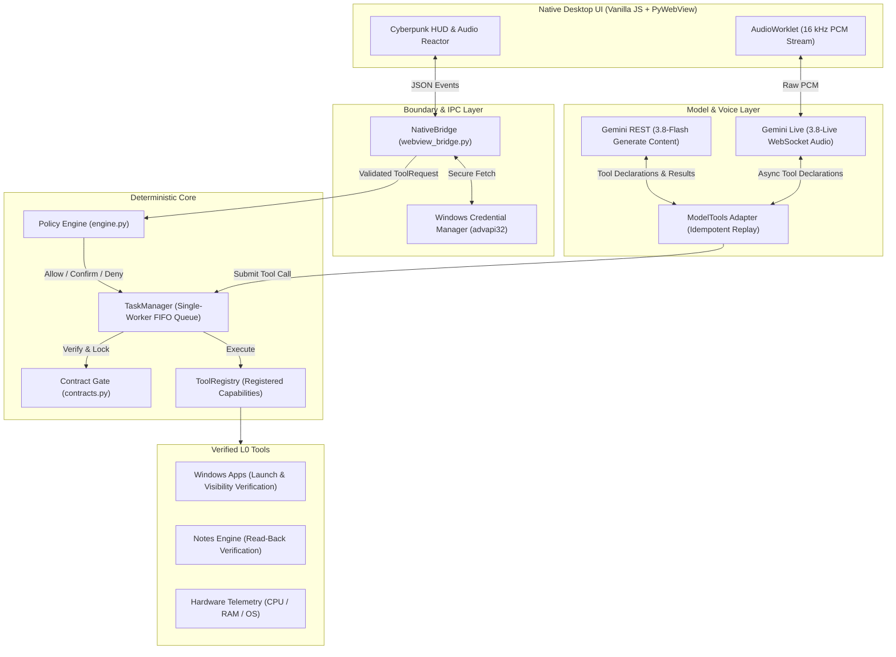

<div align="center">

# ⚡ TaskVex

### Autonomous, Lightweight & Privacy-First Native Windows AI Assistant
**Powered by Google Gemini 3.8 Live & Flash | Zero Electron | Pure Python & Vanilla JS**

[](https://www.python.org/)
[](https://www.microsoft.com/windows)
[](v1/tests)
[]()
[](LICENSE)

<br/>

*TaskVex is a deterministic, second-monitor companion and autonomous desktop agent. It combines sub-second real-time voice streaming via Google Gemini Live API with a battle-tested, bank-grade execution pipeline.*

</div>

---

## 🌟 Why TaskVex?

Most desktop AI assistants today are bloated Electron wrappers that consume 500 MB of RAM, execute unconstrained shell commands, and store your API keys in plaintext `.env` files. 

**TaskVex takes a fundamentally different engineering approach:**

| Feature | TaskVex | Conventional AI Desktop Wrappers |
| :--- | :--- | :--- |
| **Memory Footprint** | **~45 – 60 MB RAM** (Idle / Active) | 350 – 600 MB RAM |
| **Engine** | **Native Edge WebView2 + Python** | Chromium + Node.js + Electron |
| **Frontend Dependencies**| **Zero npm packages** (Vanilla ES Modules + CSS) | 1,000+ `node_modules` dependencies |
| **Tool Execution** | **Deterministic Single-Worker FIFO + Policy Engine** | Blind shell / uncontrolled agent execution |
| **Credential Security** | **Windows Credential Manager** (`advapi32.dll`) | Plaintext `.env` / `config.json` |
| **Verification Standard** | **Read-back & OS evidence required** (`verified=True`) | Assumed success on tool call |
| **Voice Streaming** | **Sub-second Gemini 3.8 Live WebSockets** | Clunky REST STT ➔ LLM ➔ TTS cascades |

---

## 🏛️ Architectural Overview

TaskVex is built on strict architectural boundaries and **Design by Contract**. The LLM is never treated as an autonomous operating system user; it acts solely as a structured input generator.



### Core Tenets:
1. **Single-Worker FIFO TaskManager:** Prevents race conditions and duplicate side-effects. Tasks are queued and executed strictly in order.
2. **Mandatory Evidence & Verification:** A tool cannot report `SUCCEEDED` without proving its work. Notes are verified by immediately reading back the disk state; apps are verified through `WS_VISIBLE` window handles. Unverified tasks are marked `UNKNOWN` and freeze execution to protect user data.
3. **OS-Level Credential Protection:** API keys are never stored in configuration files or Git repositories. They are encrypted directly into the Windows Credential Store using native Win32 APIs.

---

## 🚀 Key Features

* 🎙️ **Real-Time Gemini Live Audio:** Streaming 16 kHz mono PCM capture through browser `AudioWorklet` directly to `gemini-3.8-live` over WebSockets, with sub-second conversational latency and streaming audio playback.
* 💬 **Hybrid Text & Tool Execution:** Fast, deterministic command processing with `gemini-3.8-flash` utilizing function calling for desktop tools.
* 📊 **Cyberpunk Telemetry HUD:** Real-time hardware telemetry (CPU, RAM, OS version) and Web Audio API reactive waveform canvas rendered directly on the GPU.
* 📝 **Read-Back Verified Notes:** Native CRUD notes system backed by atomic file writes with confirmed legacy migration and backup restore.
* 🖥️ **Windows Application Control:** Launch and verify system applications with explicit capability checks and window handle discovery.
* 🧪 **727 Automated Tests:** Comprehensive suite covering contracts, concurrency locks, state machines, transport mocks, and WebView2 lifecycles.

---

## 📦 Getting Started

### Prerequisites
* **Windows 10** (Build 19041+) or **Windows 11**
* **Python 3.11+** (tested and verified with Python 3.14)
* **Microsoft Edge WebView2 Runtime** (installed by default on Windows 10/11)
* A **Google Gemini API Key** (from [Google AI Studio](https://aistudio.google.com/))

### 1. Clone the Repository
```powershell
git clone https://github.com/Walbertb4/TaskVex.git
cd TaskVex/v1
```

### 2. Setup Virtual Environment
```powershell
# Create virtual environment
python -m venv .venv

# Install frozen dependencies
.\.venv\Scripts\python.exe -m pip install -r requirements-dev.lock.txt

# Verify package integrity
.\.venv\Scripts\python.exe -m pip check
```

### 3. Run the Test Suite
Ensure the deterministic core and bridge tests pass (727 tests):
```powershell
.\.venv\Scripts\python.exe -m pytest
```

### 4. Launch TaskVex
```powershell
.\.venv\Scripts\python.exe -m app.main
```
> **Tip:** Add `--debug` to enable Chromium Developer Tools within the native window.

### 5. Add Your Gemini API Key
You can configure your key in two ways:
* **Via Desktop UI:** Open TaskVex, navigate to **Settings ➔ Connection**, paste your Gemini API key, and click **Save**. It will be securely stored in Windows Credential Manager.
* **Via Environment Variable:**
  ```powershell
  $env:GEMINI_API_KEY = "your_api_key_here"
  ```

---

## 📁 Repository Structure

```text
TaskVex/
├── ARCHITECTURE.md           # Master architectural roadmap & design rules
├── AGENTS.md                 # Ponytail strict development instructions
├── CORE_START_PLAN.md        # Core stage implementation decisions
├── LICENSE                   # MIT License
├── README.md                 # Project documentation
├── docs/                     # Specifications per architectural stage (Stage 1 to 5)
└── v1/                       # Core codebase (Stage 1 – 5)
    ├── pyproject.toml        # Declared project dependencies
    ├── requirements-dev.lock.txt # Frozen environment lockfile
    ├── app/
    │   ├── main.py           # Native entry point (PyWebView host)
    │   ├── bootstrap.py      # Core factory & dependency wiring
    │   ├── config.py         # Data directories & environment paths
    │   ├── core/
    │   │   └── contracts.py  # Strict types, TaskStatus, ToolResult invariants
    │   ├── tasks/
    │   │   └── manager.py    # Single-worker FIFO task queue & lifecycle
    │   ├── policy/
    │   │   └── engine.py     # Deterministic allow / confirm / deny rules
    │   ├── session/
    │   │   ├── gemini.py     # Google GenAI REST adapter
    │   │   ├── model_tools.py# Tool specification & call serializer
    │   │   └── tool_registry.py # Namespaced capability directory
    │   ├── storage/
    │   │   ├── credentials.py# Windows Credential Manager (advapi32.dll)
    │   │   └── json_store.py # Atomic write & read-back JSON store
    │   ├── bridge/
    │   │   └── webview_bridge.py # Safe IPC event dispatcher & JSON serializer
    │   └── tools/local/      # Local L0 tools (apps, notes, telemetry)
    ├── ui/                   # Vanilla JS + CSS Cyberpunk Interface
    │   ├── index.html        # App window layout
    │   ├── styles.css        # Responsive styling & neon visual theme
    │   └── js/               # Modular ES modules (api, reactor, sfx, etc.)
    └── tests/                # 727 unit, integration, and wire tests
```

---

## 🗺️ Roadmap

- [x] **Stage 1:** Common Contracts, ToolRegistry, FIFO TaskManager, Atomic Storage.
- [x] **Stage 2:** PyWebView Native Edge Host, Settings & Window State Bridge.
- [x] **Stage 3:** Backend Authority for Notes CRUD, Verified Read-Back, Backup & Restore.
- [x] **Stage 4:** Windows Application Catalog & Verified Launch with Window Discovery.
- [x] **Stage 5.1 - 5.3:** Gemini REST & Live ModelTools adapter, Windows Credentials store.
- [ ] **Stage 5.4 - 5.5:** Continuous VAD, bidirectional barge-in voice loop, device persistence.
- [ ] **Stage 6:** In-Process Local Discord Voice Bot & Remote Telegram Tunnel.
- [ ] **Stage 7:** Native GUI Automation (Pixel-difference & Accessibility APIs).
- [ ] **Stage 8:** Custom Plugin System (`plugins/` dynamic loader) & Inno Setup one-click installer.

---

## 🤝 Contributing

Contributions are welcome! Please follow these principles:
1. **Maintain Architectural Integrity:** Review [`ARCHITECTURE.md`](ARCHITECTURE.md) and [`AGENTS.md`](AGENTS.md) before submitting pull requests.
2. **Minimal Code:** The best code is the code never written. Solve problems with the minimum necessary diff.
3. **No Unchecked Logic:** Every new branch, tool, or handler must be accompanied by unit tests. Run `pytest` to ensure all 727+ tests pass.

---

## 📄 License

This project is licensed under the **MIT License** — see the [LICENSE](LICENSE) file for details.
