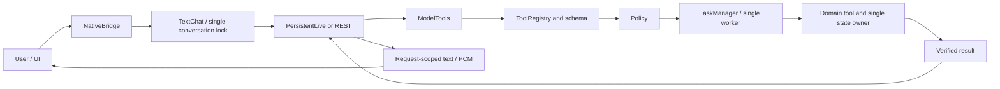

# TaskVex — Current architecture

This is a design and ownership guide, not a development diary. Current work is
tracked in [PLAN.md](PLAN.md), changes in [CHANGELOG.md](CHANGELOG.md), working
commands in [COMMANDS.md](COMMANDS.md), and the active bridge contract in
[UI_BACKEND_CONTRACT.md](UI_BACKEND_CONTRACT.md). Historical translations under
`docs/archive` do not override these documents.

## Product boundary

A Windows desktop assistant for one local user, with a vanilla HTML/CSS/JavaScript
UI, a PyWebView/WebView2 host and a Python core. Gemini Live is the main desktop
conversation path. A REST adapter remains for development and future channels.
Opening the UI in an ordinary browser does not grant native tool permissions.

## Shared execution path

The model selects structured tool calls; it is not an arbitrary code or operating-
system executor. There is no phrase/regex intent router. Local wake detection,
microphone On/Off and Stop remain local lifecycle operations.

## Owners

| Responsibility | Owner and boundary |
|---|---|
| Native host, process, restart and shutdown | `v1/app/main.py` |
| UI startup and snapshots | `ui/js/app.js`; connects modules without a second domain state |
| Conversation, microphone, sleep and Stop | `ui/js/assistant_session.js`; request and audio IDs stay together |
| Camera capture | `ui/js/live_video.js`; opt-in device resource, RAM JPEG capture and request-scoped sending under assistant_session.js |
| Live visual input | `app/session/live_video.py`; one latest-frame slot on the existing PersistentLive socket, no task executor or disk records |
| Visual shell and startup effects | `ui/js/shell.js`; does not execute model actions |
| Preference object | `ui/js/preferences.js`; settings/devices/layout share it |
| Native boundary | `app/bridge/webview_bridge.py`; versioned data, readiness and short locks |
| Model turns and conversation context | `app/session/text_chat.py`; one turn lock and ConversationMemory |
| Gemini usage accounting | `app/session/gemini.py`; one application-session counter, adapters report usage |
| Live socket and I/O loop | `app/session/live_session.py`; connection scope, resume and GoAway |
| Tool catalog and parameter schemas | `app/session/tool_registry.py`; explicit registration, no automatic plugin imports |
| Permissions | `app/policy/engine.py`; explicit local-user/desktop capability checks |
| Queue, cancellation and replay | `app/tasks/manager.py`; one worker and request-ID records |
| Persistent task records | `app/storage/task_journal.py`; SQLite journal |
| Personal memory | `app/tools/local/personal_memory.py`; shared settings store and short storage lock |
| Notes | `app/tools/local/notes.py`; stable IDs, dates, selection snapshots and atomic writes |
| Timers and stopwatches | `app/tools/local/clocks.py`; shared process-memory state and monotonic time |
| Current media and controls | `app/tools/local/media.py`; same Media instance in core/bridge; media_view.js renders it |
| Weather/location | `app/tools/services/weather.py`; shared Weather owner, bounded public-service reads and explicit native preference consent |
| System/network measurements | `app/tools/local/telemetry.py`; same Telemetry instance in core/bridge |
| Credentials | `app/storage/credentials.py`; Windows Credential Manager, no key in UI snapshots/backups |
| JSON persistence | `app/storage/json_store.py`; schema envelope, atomic replacement, corrupt-file preservation |

The settings.js compatibility re-exports reach the same implementation and
preference object. The combined audio/sleep/turn state intentionally stays in its
lifecycle owner. A large file is split at responsibility boundaries, not merely
to reduce its line count.

## Requests and verified results

ToolRequest contains request_id, source, principal, tool and JSON arguments.
Registry rejects duplicate names and invalid types, extra fields and non-finite
numbers. Policy admits only explicit principal/source/tool/capability combinations.
Parameters and results cross a copied JSON boundary; secrets and raw exceptions
are not logged.

TaskManager distinguishes queued, running, cancel_requested, succeeded, failed,
cancelled and unknown. Cancellation acceptance is not completion. A completed,
verified side effect is not rolled back by Stop or a late result.

The same request ID and payload retrieve the existing result; a changed payload
is a conflict. A historical successful result proves that old operation, not the
current external state. Persistent core stores records in `tasks/tasks.sqlite3`.
The 256-record limit bounds active work and cached RAM records, not lifetime disk
history. Terminal records can leave RAM while get/wait/cancel/replay consult the
disk index. At 256 active requests, new work is rejected. Journal-free managers
are for isolated tests/embedding and retain their older total-capacity limit.

Acceptance, pre-handler RUNNING and terminal results are separate SQLite FULL
transactions. Recovery cancels QUEUED records and marks RUNNING/CANCEL_REQUESTED
unknown, without automatically executing them. Any unknown record blocks new
tools profile-wide. Journal read/write failures stop new handlers. A verified
domain operation remains real if a later journal write fails; restart may still
see an unknown outcome. There is no generic external exactly-once guarantee.

## Domain rules

### Notes

Model note tools remain closed until the initial browser-note transfer is approved.
Real UUIDs and known creation times are preserved; old undated notes do not receive
invented dates. Before a model mutation, notes.select must produce a fresh result
in the same turn. Ambiguous single targets require clarification. Structured
latest/all/contains/ids selection supplies real IDs and expected_snapshot. Batch
deletion/completion uses one atomic write. Backend snapshots refresh the UI without
a second note_add/save mutation.

### Timers and stopwatches

Clocks is shared by bootstrap and bridge. The model exposes create/list/control;
deletion is UI-only. UI mutations also use registry/policy/TaskManager. The 500 ms
display query reads the owner without journaling every tick. Pause preserves
elapsed time; reset stops. Loss of the native bridge does not reactivate a second
browser clock engine. Clocks do not survive application exit.

Completion notifications are verified by ID/generation and use the existing
TextChat/Live/audio path in a tool-free turn. There is no second scheduler, TTS
engine or connection owner. Notifications wait while busy and are not spoken while
asleep. Stop, connection changes, deletion or restart invalidate stale notifications.
Failed/stopped announcements are not automatically repeated. This is not an OS alarm.

### Audio, sleep and conversation context

One AudioWorklet produces 16 kHz mono input. live_audio plays 24 kHz output under
the matching request ID. Speech thresholds, the prebuffer and bounded queues belong
to the same microphone owner. Mic Off stops input only; Mute silences output; Stop
ends the turn. Late PCM/transcripts never migrate to a new request. Unknown outcomes
keep relevant controls locked.

replyVolume is the existing PCM player's GainNode gain (0–1, default 1), shared
by Live/REST speech and timer announcements. Effects volume is separate. Changing
gain does not interrupt playback; unmuting restores the selected level. The setting
uses normal settings snapshot/save/backup/reset and does not change microphone or
model-session identity.

The model requests sleep through a tool; the host applies it after Vex's response
and playback finish. One-time sleep differs from return-to-sleep after each
interaction. Idle sleep is a separate 0–300 second preference. While asleep, local
wake processing does not stream ambient audio to the provider. Local wake spelling
variants and microphone calibration are not a general natural-language action parser.
Connection/Stop/scope changes must preserve existing request and cleanup rules.

ConversationMemory is bounded process-memory context. Session replacement can
retain eligible logical conversation context without blindly resending interrupted
inputs or replaying side effects. PersistentLive alone owns reconnect/resumption;
completed and unknown tool calls retain their identities and replay protections.

### Personal memory and proposals

Saved personal context is opt-in. `model_instruction` embeds enabled context as
JSON data, not instructions or permissions. REST, Live and timer turns use the
same profile snapshot. TextChat checks the enabled-memory fingerprint on the next
turn and drops old Live/RAM context when it changes; unconfirmed cleanup blocks a
new turn. Active replies are not interrupted solely to update a profile. Forgetting
does not erase earlier provider requests, visible messages, backups or task history.

With learning enabled, the model may propose clear durable self-reported facts.
Third parties, quotations, jokes, temporary/hypothetical states, secrets and sensitive
facts are excluded by model instruction, not a deterministic semantic guarantee.
ModelTools attaches the real current text/transcript as source; model-rewritten
quotations are not evidence. Missing real input is never invented. The shared
transcript gate blocks tools when appropriate; a source-less domain proposal fails.
When proposal mode is enabled, even explicit additions use memory.propose rather
than memory.patch append. Explicit correction/forgetting retain their normal path.

Review mode holds at most one pending candidate in RAM: 1,000 characters, with
source bounded by the 20,000-character input limit. A new candidate invalidates
the old ID. Restart is not approval and loses the pending RAM candidate. Candidates
are not profile/backup data, though task history can retain requests and results.
memory.decide requires a fresh memory.read and the real pending ID in a later user
turn; another read in the proposal's own turn cannot self-approve it.

prof.pMemoryConfirm defaults to true. Separate Save/Dismiss controls appear beside
conversation controls, not inside Personalization. Vex asks naturally through the
existing response/audio path. A later explicit unambiguous spoken/typed decision
uses memory.read -> memory.decide. Ambiguous replies are not consent; semantic
interpretation remains a model responsibility. Buttons use the same registry,
policy and TaskManager path, not UI-supplied approval text.

If the user disables confirmation, memory.propose uses the existing append/readback
logic to save directly to the single profile. Only the UI can select this preference;
the model cannot enable auto-save or approve its own same-turn proposal. The
preference belongs to the snapshot, so changing it invalidates an old read.
memory.propose therefore requires memory.write. Save verifies persistence/readback;
dismiss does not change the profile. Failed or unknown outcomes do not trigger an
automatic retry/merge. Late decided_id results cannot hide a newer candidate.
UI profile refresh preserves drafts and never starts a second save cycle.

### Live voices

conn.voice is separate from pLang/pIns. catalog.py contains one allowlist of
Google's 30 documented preset Live voices; it is not an API-discovered voice list.
Model discovery still uses the API. Empty/legacy voice preferences fall back to
Puck. Native input snapshots language/instructions/voice together; Live text,
microphone and timer replies use the same TextChat/PersistentLive path.
speech_config sets the selected voice. A voice change changes connection identity,
invalidating old resumption handles/call maps without changing an active turn's
snapshot. The separate REST TTS voice is not controlled by this preference.

## Data and persistence

Source runs use TASKVEX_HOME or `%LOCALAPPDATA%/TaskVex`. settings.json stores
allowed preferences; notes.json stores backend notes. Credentials use Windows
Credential Manager. Skill/routine definitions currently use localStorage, not
generic backend save. Import validates the whole candidate before application.
Legacy jarvis_ui is read only for migration; new browser writes use taskvex_ui.

Atomic JSON replacement protects single-process writes. Native SingleInstance
holds an OS file lock for the profile throughout window/core lifetime; restart
launches only after it is released. A crash releases the OS handle. Different
profiles are independent. JsonStore alone is not a process lock. Persistent core
also holds tasks/instance.lock, preventing direct create_core scripts from opening
a second worker for that profile. Shutdown keeps the lock until the worker ends.
Corrupt/future-version journals stop startup without silent reset or recovery.

The local journal is unencrypted and can retain deleted note text and personal
proposal/source data. It is not secret storage and is excluded from JSON backup.
Disk history is retained indefinitely; validation cost grows with it, while RAM
does not load every record. Domain writes and journal writes are not one atomic
transaction. Unknown reconciliation has no UI yet; restart does not clear it.
Deleting the journal removes replay protection and is not a recovery procedure.
Tests use temporary profiles and synthetic transports.

## Local system measurements

Telemetry owns the two-second cache and CPU baseline. Windows GetSystemTimes,
GlobalMemoryStatusEx, GetSystemPowerStatus and foreground-process queries supply
CPU/RAM/battery/process data; shutil.disk_usage supplies runtime-volume occupancy,
not disk throughput. Only the foreground executable name leaves the adapter;
document/window titles and full paths are not collected. Initial/reset CPU samples
and systems beyond the supported 64-logical-processor scope return None.

system.status uses system.read through the normal model tool path. query_system
reads the same owner without adding a journal task. The existing one-second UI
tick starts nonoverlapping queries at least three seconds apart. No second sampler
thread/timer/state exists. Failure or twelve-second staleness clears readings.
Model offline status does not invalidate local CPU/RAM measurements.

### GPU

windows_gpu.py reads GPU Engine counters through Windows PDH, using
PdhAddEnglishCounterW independently of OS display language. It does not run vendor
commands, open Task Manager or add a sampler/package. One WindowsGpu belongs to
Telemetry; query handles close on errors/shutdown, with a finalizer fallback.
First collection establishes a baseline; a recreated query warms up again.

Process counters are summed per adapter/physical engine. An adapter's reported
utilization is its busiest engine; the dashboard shows the busiest adapter, not
the sum of unrelated engines/cards. gpu_devices IDs are OS counter identities,
not product names or Task Manager GPU 0/1 ordering. Process IDs are not exported.
Intel/AMD/NVIDIA adapters work when Windows exposes suitable WDDM counters; there
is no universal old-driver/hardware guarantee. Temperature and VRAM capacity remain
unavailable. CPU temperature is not inferred from GPU/ACPI values. Sampling and
adapter choice can differ from Task Manager.

### Physical network traffic and quality

network.py adapts GetIfTable2. One Network inside Telemetry owns prior RX/TX
samples and uses the same two-second lock/cache. Select physical, non-filter,
non-endpoint, non-loopback, non-tunnel interfaces. Divide 64-bit active-interface
byte deltas by elapsed time; interface changes/counter resets establish a new
baseline. First speed is None; unchanged counters produce real zero. FreeMibTable
releases allocated tables in finally. Source failure does not invalidate CPU/RAM/GPU.

Outputs contain link kind/status, Wi-Fi connected status and RX/TX bytes per second;
the UI converts rates to Mbps. No SSID, IP/MAC, profile/interface name is exported.
Traffic is not a speed test, link capacity or proof of internet access. VPN/virtual
counters are excluded to prevent double counting, so virtual-only setups are outside
complete physical-traffic coverage. Model/API status is not local-link status.

network_quality.py is a bounded Win32 adapter; Network owns its ten-second cache
under the Telemetry lock. Physical-interface/route changes refresh quality early.
The lowest-metric active physical IPv4 default route selects a local gateway.
One small IcmpSendEcho waits at most 250 ms; there is no DNS, arbitrary target,
public-server probe or scan. The shared measurement lock can wait during this
probe. Timeout is not proof of internet failure. VPN-only/IPv6-only gateways are
outside this scope.

Wi-Fi uses WlanQueryInterface realtime_connection_quality, without sensitive
current_connection/BSS/scan fallbacks or location permission. Read at most 16
connected physical Wi-Fi adapters; report the lowest quality for multiple adapters,
or None if a required query fails. Zero quality is valid. Output contains only
milliseconds/percentage, status and monotonic sample time, not route addresses,
GUID/index or SSID/MAC. Query polling can trigger the bounded gateway probe but
does not journal every sample. WLAN clients/buffers and ICMP handles close in finally.
API transport latency is not derived from local traffic or total reply time.

### Current Windows media session

main gives the same Media instance to create_core and NativeBridge. media.status
uses media.read and the shared model execution path; query_media reads the same
snapshot without growing the task journal. Model reads can journal title/artist.

Read Windows GSMTC's current session, not every application/tab or raw speaker
output. Metadata is title/artist/playback state published by the source app; no
album art, window title, tab URL, file path or microphone capture is collected.
Treat metadata as data, never instructions. WinRT runtime/Foundation/Media/
Media.Control projections supply API types, not a new player or model framework.

The backend caller runs a temporary asyncio loop with a two-second wait bound.
MTA initialization/uninitialization is balanced without forcing another apartment
mode. The owner retains the private Agile manager and its session reference for exact target identity;
WinRT objects never enter JSON, UI snapshots or task records. One lock/cache shares two-second
samples; session changes during await invalidate old results. media_view.js uses
the existing tick, at least three seconds between nonoverlapping queries, and clears
after ten seconds without fresh data. no_session is distinct from unsupported,
unavailable, timeout and session_changed. Failures clear stale titles/animations.
media.control has separate media.control permission and shares this owner through
the registry/policy/TaskManager path. UI media_command submits the same tool; it is
not a second executor. The model must read media.status in the current turn and
use its opaque target_id. Session, metadata, state or capability changes invalidate
that target. Native revalidation occurs immediately before a single dispatch.

Play/pause succeed only after observing the desired state; next/previous require
changed title/artist on the same session. The native acceptance boolean alone is
not completion. A same-title skip or previous-track restart cannot be proved with
this metadata contract and may be unknown. Unknown results latch the existing
persistent TaskManager safety lock; polling/restart do not authorize a retry.
Stop prevents undispatched actions but preserves confirmed effects already made.
The native control wait is four seconds, bridge wait eight and UI deadline ten.
Model replies and manual media controls exclude each other; stale/unsupported
controls remain disabled. There is no arbitrary session/app selector or system/master-volume tool.

Manager activation is lazy and reused across UI polls and worker controls. Different
GSMTC manager instances can expose unequal session objects for the same underlying
player; identity comparisons are valid only within the issuing manager. Source loss
invalidates that manager and its target before a later read reacquires it. An empty
current session retains the manager so a newly opened player can be observed.

Player volume is media.control action set_volume, through the same permission,
queue, replay and Stop rules. media_volume.py is a native adapter, not a second
state owner: it enumerates active render endpoints and matches audio-session
process identity to the GSMTC source app ID or exact executable name/stem. A
single active match takes precedence over old inactive sessions; multiple active
matches, or multiple inactive matches with no active session, disable control.
Private endpoint/session instance IDs bind the observed target and never enter
snapshots or journals. An audio target change rotates the existing media target ID;
volume-level changes do not. Core Audio references/strings/process handles are
released on the same calling thread, including failure paths.

Only ISimpleAudioVolume changes application volume, with an absolute 0-100 value
and readback within 0.1 percentage points. No endpoint/master volume, keyboard
shortcut, Vex reply-volume or mute write is used. A browser target is browser audio,
not one tab. Unknown/unsupported mapping never falls back to system volume. Polling
reads Windows' actual level; this is not a saved TaskVex preference. The UI range
commits once on change and shows confirmed values; its status remains screen-reader
accessible without visible dashboard text. Controls and range use the saved UI theme.
[Session volume API](https://learn.microsoft.com/en-us/windows/win32/api/audioclient/nn-audioclient-isimpleaudiovolume).

## Weather and approved location

main shares one Weather instance and settings JsonStore between core and bridge.
weather.locations/current use weather.read through ModelTools/registry/policy/
TaskManager. query_weather reads the same cache without journaling each dashboard
poll. Open-Meteo is a public L0 service adapter, independent of Gemini connectivity.
No provider request occurs before a saved location or an explicit place search.

Manual search returns up to five actual place IDs/labels. Neither UI nor model may
silently choose the first ambiguous result. The UI's explicit selection saves a
default location. Auto requests browser geolocation only after a user click and
sharing confirmation; coordinates are rounded to two decimal places before transfer
and persistence. Startup reuses the approved place without asking for geolocation.
Clear removes it. Model reads/searches cannot change this preference or request GPS.
The setting uses JsonStore's existing lock and write/readback, preserving other
preferences; generic save/import cannot grant or replace location consent.

Forecast and geocoding URLs are fixed HTTPS endpoints, without redirects, keys,
arbitrary URLs or automatic retries. Responses are size/time bounded and validated
for units/ranges/timestamps. Data is modelled current weather, not a local sensor
or a future forecast. A ten-minute cache avoids continuous provider calls; failed
refreshes back off for one minute. Cached values remain explicitly stale for at
most one hour, then clear. Missing measurements never become zero. UI polling uses
the existing tick once per minute; late responses from a former selection cannot
replace the current view. Source/model time remains visible; provider attribution is in README.md and THIRD_PARTY_NOTES.md.

Location preferences are native-only and currently excluded from the legacy UI JSON
backup, avoiding silent geolocation consent through imports. City/provider data in
tool results is untrusted content; saved coarse coordinates stay out of model results
and polling logs, but remain ordinary local settings, not credential storage.
Provider terms/attribution are recorded in THIRD_PARTY_NOTES.md.

## Target L0 and four GUI layers — planned

- L0: API/local-tool/plugin capabilities; Drive/Calendar/mail/messaging are service
  adapters, not new architecture layers.
- L1: context-bound verified target/procedure memory.
- L2: DOM/CDP target resolution when available.
- L3: Windows accessibility/UIA target resolution.
- L4: vision/screen target resolution within a bounded budget.

Resolvers propose targets/methods. Execution, permissions, verification and unknown
outcomes remain in the core path. Telegram/Discord are input channels, not unlimited
execution authority or new user permissions. External-content boundaries, risky-
action approval, taint tracking and channel-specific principals must precede those
integrations; they are not all implemented today.

## Not implemented

Google service integrations, screen inspection, system
audio control, file attachments, base-instruction override/greetings, backend
skill/routine execution/scheduling, GUI L1–L4 and external messaging channels.
Media metadata and bounded current-session playback controls are implemented. Preserve existing
definitions/user text and clearly mark controls without executors as planned/disabled.

## Packaged demo host

`v1/tools/demo_entry.py` is a frozen entry point that calls normal app.main.run,
with the same core/bridge lifecycle. Default profile is
`%LOCALAPPDATA%/TaskVexDemo`; an explicit TASKVEX_HOME override remains supported.
Frozen restart launches the same EXE rather than passing Python module arguments.
UI assets live in `_internal/ui`; user data is never bundled. build_demo.py is a
build tool, not another application executor. Wake weights are downloaded only by
explicit setup and are not redistributed with the demo.

## Licensing and maintenance

Original TaskVex work is MIT. Reference code is not imported automatically;
third-party rights remain in THIRD_PARTY_NOTES.md. Record changes in CHANGELOG.md.
Debloating must preserve security, cancellation and verification. Create modules
for responsibility boundaries rather than arbitrary file-length targets.

## Camera input ownership

Camera On is a local user input control, like microphone On/Off, not a model tool.
Only the user can enable capture. Device IDs use the same browser device preference
adapter, with exact selection and no fallback to another camera. The browser owns
permission and its video-only track; settings store a device preference, never an
active camera grant. Startup does not open the camera or request permission.

During an active Live user turn, the camera owner supplies bounded JPEG input through
NativeBridge -> TextChat -> PersistentLive -> probe_live_text on the existing socket.
Text turns receive an initial image before their prompt; speech frames follow the
same explicit activity start as PCM. One sender samples at most once per second,
retaining only the latest frame and dropping queued images older than two seconds.
Images are capped at 256 KiB; browser capture scales the longest edge to 640 pixels.
JPEG framing/size are checked at the boundary; actual image decoding is the provider's
responsibility. No second connection, tool executor, audio player or frame history exists.
Provider contract: [Live video input](https://ai.google.dev/gemini-api/docs/live-api/capabilities#sending-video).

Idle camera frames stay local. Camera Off releases the device and closes only the
video input; microphone and model output continue. Stop ends current transmission,
while camera may remain locally ready for a future user message. Sleep, Disconnect,
model/key/mode change, unknown results, shutdown and pagehide release capture.
Request IDs/sequences reject stale or duplicate frames; no reconnect replays pixels.
Already sent/in-flight images cannot be recalled; Camera Off does not erase provider
conversation context. Image content is observation data, not action authorization;
model actions still require the existing tools, policy and TaskManager.

## Permission settings

Settings > System > Permissions is owned by ui/js/permissions.js. It queries
browser permission status only when opened/refreshed; status queries never start
capture or geolocation. Explicit Request access uses a short default-device probe
and stops every returned track immediately, or requests one approximate position
and discards it. Existing live_mic/live_video capture is not replaced; an active
device does not need a second probe. No toggle, profile grant flag, Live socket,
weather preference or provider request is created. Timeouts/pagehide reject stale
results, and a late media grant still releases its tracks.

The browser and Windows control actual permission and persistence. Unsupported
status queries remain Not reported; browser Allowed is not a guarantee of working
hardware or OS policy. NativeBridge.permission_settings opens one of three fixed
Windows privacy URIs from a user button. It cannot take arbitrary URLs or grant
access; remembered browser denials and Windows policy may still require user action.
