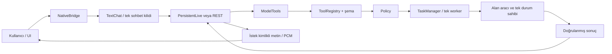

# TaskVex — Güncel mimari

Bu belge mevcut tasarımın rehberidir; günlük veya değişiklik kaydı değildir.
İlerleme [PLAN.md](PLAN.md), değişiklikler [CHANGELOG.md](CHANGELOG.md), çalışan
komutlar [docs/COMMANDS.md](COMMANDS.md), köprü sözleşmesi
[docs/UI_BACKEND_CONTRACT.md](UI_BACKEND_CONTRACT.md) içindedir.
Eski tasarım/kabul notları docs/eski altındadır ve güncel talimat sayılmaz.

## Ürün ve sınır

Windows’ta tek yerel kullanıcı için masaüstü asistanı. Vanilla HTML/CSS/JS UI,
PyWebView2 host ve Python core bulunur. Ana konuşma yolu Gemini Live’dır.
REST adaptörü test ve gelecekteki farklı kanallar için korunur. Yerel UI tek
başına tarayıcıda açılabilir; bu mod native araç yetkisi kazandırmaz.

## Ana akış

Model doğal dili yapılandırılmış araç çağrısına çevirir; kendisi kod/işletim
sistemi yürütücüsü değildir. Cümle regex’i veya uygulamaya özel niyet router’ı
kurulmaz. Yerel wake-word, Mic On/Off ve Stop dil yorumlama değildir; kendi
yaşam döngüsü sahibinde kalır.

## Modüller ve tek sahiplik

| Sorumluluk | Tek sahip / sınır |
|---|---|
| Host/pencere/süreç | v1/app/main.py; kontrollü başlangıç, restart ve kapanış |
| UI başlangıcı/snapshot | ui/js/app.js; modülleri bağlar, ikinci alan state’i tutmaz |
| Sohbet/mikrofon/uyku/Stop | ui/js/assistant_session.js; bağlı istek ve ses kimlikleri birlikte tutulur |
| Görsel kabuk | ui/js/shell.js; balon, saat ve açılış efektleri; model çalıştırmaz |
| Tercih nesnesi | ui/js/preferences.js; settings.js doğrular/kaydeder; layout.js ve devices.js aynı nesneyi kullanır |
| Native API sınırı | app/bridge/webview_bridge.py; sürümlü veri, hazır durumu ve kısa kilit |
| Model turu/bellek | app/session/text_chat.py; tek tur kilidi, ConversationMemory |
| Live bağlantısı | app/session/live_session.py; tek I/O loop/socket sahibi; scope, resume ve GoAway |
| Araç kataloğu/parametre | app/session/tool_registry.py; açık kayıt, JSON schema; otomatik plugin import yok |
| Yetki | app/policy/engine.py; yerel kullanıcı ve desktop kaynağı için açık izin |
| Yürütme/replay/iptal | app/tasks/manager.py; tek worker ve request_id kaydı; storage/task_journal.py kalıcı SQLite deposu |
| Kullanıcı hafızası | app/tools/local/personal_memory.py; aynı settings.json profili, taze snapshot ve paylaşılan kısa depo kilidi |
| Not | app/tools/local/notes.py; ID/tarih/seçim/snapshot ve tek dosya yazımı |
| Timer/stopwatch | app/tools/local/clocks.py; süreç RAM’i, monoton saat; UI/model aynı nesne |
| Sır | app/storage/credentials.py; Windows Credentials; UI store/JSON/yedekte anahtar yok |
| Dosya kayıt | app/storage/json_store.py; schema envelope, atomik replace ve bozuk kaydı koruma |

settings.js içindeki cihaz/layout re-export’ları mevcut çağıranları kırmadan aynı
uygulamaya ulaşır; ikinci implementasyon veya ikinci tercih nesnesi değildir.
assistant_session.js içindeki ses/uyku/tur durumu kasıtlı olarak birlikte kalır;
sırf satır azaltmak için paylaşılan durumu kopyalayan alt yöneticiler oluşturulmaz.

## Core sözleşmesi

- ToolRequest: request_id, source, principal, tool, JSON arguments.
- Registry aynı ismi sessiz ezmez; tür/ek alan/sonlu sayı denetimini yapar.
- Policy yalnız izinli principal/source/tool/capability birleşimini kabul eder.
- TaskManager queued/running/cancel_requested/succeeded/failed/cancelled/unknown
  durumlarını ayırır. İptal kabulü bitiş değildir; handler öncesi ve sonrası sonuç
  doğru raporlanır. Doğrulanmış yan etkiyi Stop geri almış sayamaz.
- Aynı kimlik+aynı içerik mevcut sonucu verir; farklı içerik çakışmadır.
  Native core bu kaydı tasks/tasks.sqlite3 içinde kalıcı tutar. Aynı kimlik tekrar
  handler çalıştırmaz; kayıt eski sonucun kanıtıdır, güncel ölçüm/nesne değildir.
- Parametreler ve sonuçlar JSON sınırında kopyalanır; sırlar/ham exception loglanmaz.
- Kalıcı core'da capacity=256 RAM kayıt/aktif iş sınırıdır; terminal kayıtların RAM
  kopyaları gerektiğinde çıkarılır. Eski get/wait/cancel/replay disk indeksinden
  sonuç verir. 256 aktif iş doluysa yenisi reddedilir; disk geçmişi silinmez.
  Günlüksüz TaskManager yalnız izole test/gömülü kullanım içindir; eski toplam
  kapasite sınırını korur, restart garantisi vermez.
- Kabul, handler öncesi RUNNING ve terminal sonuç ayrı FULL SQLite transaction'larıdır.
  Restart'ta QUEUED iptal olur, RUNNING/CANCEL_REQUESTED unknown olur; hiçbiri otomatik
  çalıştırılmaz. Herhangi bir unknown yeni işleri profil genelinde engeller.
  Günlük yazma/okuma hatası yeni handler'ları durdurur. Araç bitişi doğrulanmışsa
  geç disk hatası o gerçek sonucu geri almaz; restart kaydı unknown kalabilir.

## Alan kuralları

### Notlar

İlk yerel not aktarımı kullanıcı tarafından onaylanmadan model not araçları açılmaz.
Gerçek UUID ve oluşturulma zamanı korunur; eski tarihsiz kayıt için tarih uydurulmaz.
Model değişiklikten önce aynı turda notes.select çağırır. Tekli belirsizlikte işlem
yoktur; latest/all/contains/ids seçimi yapılandırılmıştır. Toplu silme/tamamlama tam
ID kümesi+expected_snapshot ve tek atomik commit kullanır. UI backend’den yenilenir;
ikinci note_add/save geri beslemesi üretilmez.

### Sayaçlar

Clocks aynı örnek olarak bootstrap ve bridge’e verilir. create/list/control model
kataloğundadır; delete yalnız UI’a açıktır. UI mutasyonları da registry/policy/
TaskManager hattından geçer. 500 ms görünüm sorgusu aynı snapshot’ı okur, her tik
TaskManager kaydı açmaz. Pause süreyi korur; reset durdurur; native köprü kaybı eski
tarayıcı motorunu tekrar açmaz. Sayaçlar uygulama kapanınca kaybolur.

Bitiş bildirimi id/generation ile doğrulanır; mevcut TextChat/Live/ses hattında
araçsız turdur. Yeni scheduler/TTS/bağlantı sahibi yoktur. Meşgulken bekler,
uyurken konuşmaz; Stop/bağlantı değişimi eski pending olayları düşürür. Başarısız
veya durdurulmuş bildirim otomatik tekrarlanmaz. UI alarmı OS alarmı değildir.

### Ses, uyku ve hafıza

Tek AudioWorklet akışı 16 kHz mono PCM girişini üretir; live_audio 24 kHz çıktıyı
aynı istek kimliğinde oynatır. VAD aday/eşik, ön tampon ve sınırlı kuyruklar aynı
mikrofon sahibindedir. Mic Off yalnız girişi keser; Mute çıktıyı susturur; Stop
turu durdurur. Geç PCM/transkript yeni mesaja taşınmaz; unknown kontrolleri kilitler.

replyVolume (0–1, varsayılan 1) aynı live_audio PCM oynatıcısının GainNode
kazancıdır. Live/REST sesleri ve konuşulan timer bildirimi paylaşır; SFX vol
ayrıdır. Değişiklik mevcut sesi kesmeden uygulanır; Mute yalnız çıkışı sıfırlar,
kaldırılınca seçili seviyeye döner. Tercih aynı settings save/snapshot/yedek/reset
yolundadır; model oturumu veya mikrofon ayarı değildir.

Uyku isteği model aracıyla kabul edilir, Vex’in yanıt/ses bitişinden sonra mevcut
host tarafından uygulanır. Tek seferlik uyku ve her etkileşimden sonra tekrar
uyuyan kalıcı kip ayrıdır. Idle sleep ayrı 0–300 s tercihidir. Uyurken PCM yerel
KWS’ye gider; Google’a sıradan ortam sesi yollanmaz. Wake hit’i ses sınırı ve UI
buffer’ı doğrulandıktan sonra kabul edilir. KWS sözcük/duyarlılık kapsamı değişince
cache yeniden kurulur; eski hit ve PCM tekrar kullanılmaz.

Geçici hafıza TextChat RAM’indedir: 12 tur / 16.000 JSON karakteri / taraf başına
2.000 karakter; eski turlar bırakılır, otomatik özet API’si yoktur. Stop/Disconnect
belleği korur; kapanış/anahtar değişimi temizler. New Chat UI düğmesi yoktur;
internal new_chat reset endpoint'i test/gelecek kanal uyumluluğunda korunur.

Kalıcı kullanıcı bağlamı settings.json/prof.pMem metnidir; tek
tercih sahibi/depo korunur. prof.pMemory varsayılan false açık gönderim tercihidir;
eski pMem metni kendiliğinden modele gitmez. Kullanıcı Personalization'da
metni görür/düzeltir/temizler ve mevcut Save profile yoluyla kaydeder. Ayrı DB veya öğrenme servisi yoktur. Kullanıcının öğrenme/kayıt tercihine uymayan model çıktısı
kalıcı kullanıcı bilgisi sayılmaz; profil araç yetkisi vermez.

memory.read ve memory.patch yalnız açık gönderim tercihi etkinse REST/Live
kataloğundadır; timer bildirimleri araçsız kalır. Açık kullanıcı isteği model
üzerinden aynı ModelTools → registry/policy → TaskManager hattına gider.
Her mutasyondan önce aynı turda taze memory.read gerekir. append ekler;
replace/forget tam ve tekil metni hedefler; clear açık tümünü unut isteğidir.
Snapshot aradaki metin/izin değişimini reddeder; belirsiz hedefte tahmin yoktur.
Ortak ayar şeması app/storage/settings.py içindedir; alan aracı UI köprüsüne
bağımlı değildir. Native main aynı JsonStore örneğini core ve bridge'e verir;
UI save/reset ve hafıza read/modify/write bu örneğin RLock kilidini paylaşır.
Kilit ağ turu veya core beklemesi boyunca tutulmaz. Eski UI memoryBase'i
hafızayı ezemez; çakışma görünür ret verir, otomatik merge/retry yoktur.
Model turu bittikten sonra bridge güncel profili diskten yanıt zarfına ekler;
UI aynı loadStore yoluyla, outbound save üretmeden güncellenir. Eski replay
sonucu güncel profilin yerine yazılmaz. Başarılı işlem Stop ile geri alınmaz;
yazma sonrası readback hatası unknown olur. Görev günlüğü hafıza metnini
saklayabilir; forget bu geçmişi temizlemez.

prof.pLearn varsayılan false öneri tercihidir; yalnız pMemory ile birlikte
memory.propose kataloğunu açar. Ayrı çıkarım modeli veya arka plan taraması yoktur.
Aynı konuşma modeli açık birinci kişi bilgisini aday olarak seçer; üçüncü kişi,
alıntı, şaka, varsayım, geçici durum, sır ve hassas bilgi dışarıda tutulur.
Bu anlamsal eleme model talimatıdır; deterministik doğruluk iddiası değildir.

ModelTools aynı turun gerçek metnini/Live transkriptini kaynak olarak kendisi
bağlar. Modelden kelimesi kelimesine alıntı istenmez; modelin yeniden yazdığı
cümle gerçek girdi yerine kullanılamaz. Gerçek girdi yoksa kaynak uydurulmaz:
sesli girişin ortak transkript koruması araçları durdurur; alan aracına ulaşan
kaynaksız öneri normal failed sonucu verir. Kaynağı host'un bağlaması adayın
anlamsal doğruluğunu ispatlamaz.
Yeni bilgi ekleme, öneri modu açıkken ModelTools'ta memory.patch append yolundan
geçemez; açık hatırla isteği de öneri oluşturur. Düzeltme/unutma mevcut açık
komut akışını korur; öneri modu kapalıyken önceki araç sözleşmesi sürer.

İnceleme kipinde PersonalMemory en fazla bir aday RAM'de tutar (1000 karakter; kaynak alıntısı
20.000; aynı kullanıcı mesajı sınırı). Yeni aday eski ID'yi geçersiz kılar. Aday profil/yedek değildir;
yürütme günlüğü öneri isteğini/sonucunu yine saklayabilir. Restart aday onayı
sayılmaz; aday RAM'den kaybolur. memory.decide öğrenme açıkken model kataloğundadır;
yalnız sonraki kullanıcı turunda taze memory.read ile alınan gerçek bekleyen ID
kullanılabilir. Aynı turda öneri oluşturulmuşsa yeniden read bile onay açmaz;
boş kaynak girdi ve eski ID reddedilir. Kullanıcının Save/Dismiss düğmesi aynı
registry/policy/TaskManager hattına gider. Onay metni UI'dan alınmaz; alan
sahibindeki gerçek aday ve güncel izin/snapshot kontrol edilir. Save mevcut
append/readback iş mantığını kullanır; ret profil dosyasını değiştirmez.
prof.pMemoryConfirm eksik/eski kayıtta true'dur: onay gerekiyorsa öneri
sohbetin altındaki dört kontrolün sağında ayrı Save/Dismiss grubunda görünür;
Personalization açılmaz. Vex mevcut yanıt/ses hattında doğal bir soru sorar.
Sonraki açık kullanıcı kararı memory.read → memory.decide ile aynı adaya gider.
Belirsiz veya ilgisiz yanıt onay sayılmamalıdır; anlamsal ayrım model sorumluluğudur.
Kullanıcı checkbox'ı false olarak kaydederse memory.propose yeni bilgiyi aynı
_apply append/readback üzerinden doğrudan tek profile yazar. Model auto-save
tercihini değiştiremez veya kendi önerisini aynı turda onaylayamaz. Onay tercihi snapshot'ın parçasıdır; tur
ortasında değişen tercih eski okumayı geçersiz kılar. memory.propose bu nedenle
memory.write yetkisi ister. Doğrudan kayıtta yeni öneri penceresi açılmaz ve
backend profili aynı mevcut snapshot yoluyla editöre yansır.
Sonuç doğrulanmazsa otomatik tekrar/merge yoktur; belirsiz kararda yeni model
isteği ve karar kontrolleri engellenir. Onaylanan bilgi tek profilden UI'a
yansır; taslak korunur ve ikinci save üretilmez. Sesli/metinli karar ve düğmeler
aynı alan sahibini kullanır; sormadan kayıt tercihi yalnız UI'dan seçilir.
Doğrulanmış karar sonucu decided_id taşır; geç sonuç yeni adayı gizleyemez.

Ortak model_instruction yalnız opt-in metnini JSON veri olarak talimata ekler;
REST/Live/timer aynı profil snapshot'ını kullanır. TextChat değişen etkin hafıza
parmak izini sonraki turda kontrol eder; eski Live socket ve RAM geçmişini
bırakır. Kapanış doğrulanmazsa yeni tur başlatılmaz. Aktif yanıt kesilmez;
unutma geçmiş sağlayıcı istekleri, görünen mesajlar, yedekler veya disk geçmişini
silme iddiası değildir. Yerel metin/gönderim tercihi restart'ta korunur.

Live ses karakteri conn.voice tercihidir; pLang/pIns talimatından ayrıdır.
catalog.py Google'un belgelenmiş 30 hazır Live sesinin tek izinli listesidir;
model keşfi hâlâ API'dendir, ses listesi API sorgusu gibi sunulmaz. Legacy/boş
ses tercihi Puck'a düşer. Native giriş aynı kayıttan dil/talimat/ses snapshot'ı
alır; Live metin/PCM/timer yanıtı bunu aynı TextChat/PersistentLive hattına taşır.
speech_config seçili sesi setup'a koyar. Ses değişimi connection identity'yi
değiştirir; önceki resume handle/araç çağrı haritası yeni sese taşınmaz, aktif
turun snapshot'ı değişmez. Mevcut REST TTS sesi bu tercihe bağlı değildir.

## Veri ve kalıcılık

TASKVEX_HOME veya %LOCALAPPDATA%/TaskVex. Kaynak kodu/kullanıcı verisi ayrıdır.
settings.json izinli tercihleri, notes.json backend notları tutar; API anahtarı
Windows credential deposundadır. Skill/rutin tanımları şimdilik localStorage’dadır;
bunların generic save ile backend’e yazıldığı varsayılmaz. İçe aktarma önce tüm
kaydı doğrular; hatalı veri canlı/kalıcı durumu zehirlemez. Eski jarvis_ui yalnız
geçişte okunur, yeni yazımlar taskvex_ui anahtarına gider.

JSON atomik replace tek süreçte bozulmayı önler. Native main, veri kökü için
SingleInstance OS dosya kilidini core/pencere ömrü boyunca tutar; aynı kökte ikinci
uygulama açılmaz. Crash handle kilidini bırakır; restart kilit bırakıldıktan sonra
başlatılır. Ayrı veri profilleri bağımsızdır. Doğrudan core/script kullananlar bu
host kilidini atlamamalıdır; JsonStore kendi başına süreç kilidi sağlamaz.
Kalıcı core ayrıca tasks/instance.lock ile günlük/core sahipliğini korur; doğrudan
create_core kullanan script de aynı profilin ikinci worker'ını açamaz. Normal
kapanış worker bitmeden kilidi bırakmaz. SQLite dosyası bozuk/yeni sürümlüyse
başlangıç durur; otomatik boşaltma/kurtarma yoktur.

Günlük yerel, şifrelenmemiş istek/sonuç geçmişidir; silinen notun eski metni burada
kalabilir. Anahtar saklama aracı değildir ve JSON yedeğine dahil değildir. Disk
geçmişi süresiz saklanır; açılış doğrulaması geçmişle büyür, RAM'e tümü yüklenmez.
Günlük ile alan verisi/dış işlem tek transaction değildir: belirsizlikte tekrar
etmemek, genel bir exactly-once dış servis garantisi vermez. Unknown uzlaştırma
arayüzü henüz yoktur; restart tek başına kilidi temizlemez. Günlük dosyalarını
silmek tekrar korumasını kaldırır ve kurtarma yöntemi değildir. Testler geçici
veri kökü ve sentetik taşıma kullanır.

## Hedef L0 ve dört GUI katmanı — henüz uygulanmadı

- L0: API/yerel araç/plugin yeteneği. Google Drive/Calendar/Mail ve mesaj gönderme
  sağlayıcı adaptörleridir; her servis için yeni mimari katman açılmaz.
- L1: bağlama bağlı doğrulanmış hedef/reçete belleği.
- L2: varsa DOM/CDP ile hedef çözümleme.
- L3: Windows erişilebilirlik/UIA ağacıyla hedef çözümleme.
- L4: sınırlı bütçeyle vision/ekran hedef çözümleme.

Resolver yalnız hedef/yöntem önerir. Yürütme, izin, sonuç doğrulama ve belirsizlik
aynı core hattındadır. Telegram/Discord giriş kanalıdır; doğrudan sınırsız yürütme
veya yeni kullanıcı yetkisi değildir. Harici içerik/talimat ayrımı, riskli eylem
onayı, taint takibi ve kanala göre principal yetkileri dış entegrasyonlardan önce
uygulanmalıdır; bugün bunların tamamı varmış gibi davranılmaz.

## Bugün uygulanmayanlar

Google/konum/hava/media/kamera/sistem sesi/dosya ekleme; onaysız otomatik kalıcı kullanıcı öğrenimi,
base instruction override/greeting; skill/rutin backend yürütme ve
scheduler; GUI L1–L4 ve dış mesaj kanalları. Yerel tanımlar ve mevcut kullanıcı
metni korunur; yürütücüsü olmayan kontroller açıkça planlı/disabled görünür.

## Lisans ve bakım

TaskVex özgün katkıları MIT. Referans repo otomatik import edilmez; üçüncü taraf
hakları THIRD_PARTY_NOTES.md içinde korunur. Değişiklikler CHANGELOG.md’ye yazılır.
Güvenlik/iptal/doğrulama kontrolleri debloat gerekçesiyle çıkarılmaz. Yeni modül
sorumluluk sınırı için açılır; satır sayısı tek başına bölme sebebi değildir.
