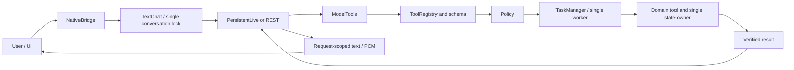

# TaskVex — Current architecture

This is a design and ownership guide, not a development diary. Current work is
tracked in [PLAN.md](PLAN.md), changes in [CHANGELOG.md](CHANGELOG.md), working
commands in [COMMANDS.md](COMMANDS.md), and the active bridge contract in
[UI_BACKEND_CONTRACT.md](UI_BACKEND_CONTRACT.md). Historical translations under
`docs/archive` do not override these documents.

Shared rules and owners are below. Detailed domain behavior is in the
[domain reference](reference/DOMAIN_ARCHITECTURE.md); search its headings and read
only the affected domain. This split changes documentation, not runtime ownership.

## Product boundary

A Windows desktop assistant for one local user, with a vanilla HTML/CSS/JavaScript
UI, a PyWebView/WebView2 host and a Python core. Gemini Live is the main desktop
conversation path. A REST adapter remains for development and future channels.
Opening the UI in an ordinary browser does not grant native tool permissions.

## Provider boundary — approved target, migration deferred

TaskVex owns tools, authorization, task execution, domain state and conversation
lifecycle; a provider adapter translates SDK requests/events into TaskVex contracts.
New Gemini details stay in provider-facing modules: SDK types, wire events,
model/voice catalogs, usage interpretation, credentials lookup and error mapping.
Core/domain features must not acquire new Gemini SDK dependencies.

This separation is partial today. ModelTools already accepts provider-neutral
id/name/arguments, and registry/policy/TaskManager are independent of google-genai.
TextChat still constructs Gemini implementations, while Live transport, speech,
catalog and bridge configuration retain provider assumptions. The final migration
must remove those dependencies through the composition boundary and shared
contracts, preserving existing lifecycle ownership. It is not implemented merely
by moving files or renaming classes. See the final provider-adapter step in PLAN.md.

Providers advertise supported text/audio/video, tools and resumption capabilities;
unsupported features are explicit, never silently simulated. A separate speech
provider can reuse the existing playback path if selected; it does not own tools
or create a competing conversation lifecycle. No universal framework is required.

## Shared execution path

The model selects structured tool calls; it is not an arbitrary code or operating-
system executor. There is no phrase/regex intent router. Local wake detection,
microphone On/Off and Stop remain local lifecycle operations.

## Owners

| Responsibility | Owner and boundary |
|---|---|
| Native host, process, restart and shutdown | `v1/app/main.py` |
| UI startup and snapshots | `ui/js/app.js`; connects modules without a second domain state |
| Conversation, microphone, sleep and Stop | `ui/js/assistant_session.js`; request and audio IDs stay together |
| Camera/screen capture | `ui/js/live_video.js`; one opt-in visual source, RAM JPEG capture and request-scoped sending under assistant_session.js |
| Live visual input | `app/session/live_video.py`; one latest-frame slot on the existing PersistentLive socket, no task executor or disk records |
| Visual shell and startup effects | `ui/js/shell.js`; does not execute model actions |
| Preference object | `ui/js/preferences.js`; settings/devices/layout share it |
| Native boundary | `app/bridge/webview_bridge.py`; versioned data, readiness and short locks |
| Model turns and conversation context | `app/session/text_chat.py`; one turn lock and ConversationMemory |
| Gemini usage accounting | `app/session/gemini.py`; one application-session counter, adapters report usage |
| Live socket and I/O loop | `app/session/live_session.py`; connection scope, resume and GoAway |
| Tool catalog and parameter schemas | `app/session/tool_registry.py`; explicit registration, no automatic plugin imports |
| Permissions | `app/policy/engine.py`; explicit local-user/desktop capability checks |
| Optional task grants (backend foundation) | `app/policy/task_scope.py`; host-issued RAM-only scope/resource/input/approval state, checked by PolicyEngine when explicitly configured; TaskManager releases accepted logical tasks on end/Stop/close; native consent consumes real pending host requests; conversation task issuance remains planned |
| GUI target references (backend foundation) | `app/automation/targets.py`; one task-bound RAM reference owner, trusted refresh callbacks and geometry/status contracts; real adapters/discovery/input remain planned |
| Tool queue, logical jobs, cancellation and replay | `app/tasks/manager.py`; one worker/Condition and per-step receipts; `app/tasks/workflow.py` holds only plan/progress contracts; intervention waits yield intake at safe checkpoints, trusted observation callbacks run outside its lock |
| Persistent task records | `app/storage/task_journal.py`; schema-3 SQLite private tool receipts and content-free logical recovery metadata; never restored grants or execution plans |
| Personal memory | `app/tools/local/personal_memory.py`; shared settings store and short storage lock |
| Notes | `app/tools/local/notes.py`; stable IDs, dates, selection snapshots and atomic writes |
| Timers and stopwatches | `app/tools/local/clocks.py`; shared process-memory state and monotonic time |
| Current media and controls | `app/tools/local/media.py`; same Media instance in core/bridge; media_view.js renders it |
| Weather/location | `app/tools/services/weather.py`; shared Weather owner, bounded public-service reads and explicit native preference consent |
| System/network measurements | `app/tools/local/telemetry.py`; same Telemetry instance in core/bridge |
| Credentials | `app/storage/credentials.py`; Windows Credential Manager, no key in UI snapshots/backups |
| JSON persistence | `app/storage/json_store.py`; schema envelope, atomic replacement, corrupt-file preservation |

The settings.js compatibility re-exports reach the same implementation and
preference object. The combined audio/sleep/turn state intentionally stays in its
lifecycle owner. A large file is split at responsibility boundaries, not merely
to reduce its line count.

## Requests and verified results

ToolRequest contains request_id, source, principal, tool and JSON arguments.
Registry rejects duplicate names and invalid types, extra fields and non-finite
numbers. Policy admits only explicit principal/source/tool/capability combinations.
Parameters and results cross a copied JSON boundary; secrets and raw exceptions
are not logged.

ToolSpec can opt into host-owned timeout/read-only/transient-error policy. The
single worker supplies one cooperative deadline and permits at most one allowlisted
failed-read retry, rechecking schema/policy/Stop. Existing registrations keep their
defaults. Elapsed time is not actual completion; late real results are preserved.
See the domain reference for telemetry and production-binding limits.

ToolRequest optionally carries a host-issued authorization_id outside tool arguments.
Its default None is omitted from serialization, preserving existing request digests.
The ID is provenance, not permission: only an active TaskScopes record plus existing
tool capabilities and the host's access resolver can authorize new scoped work.
Scopes match principal and exact (kind, opaque reference, action) grants. Resolvers
are trusted policy configuration, not model fields or plugin-declared permissions.
Missing/foreign/revoked scopes and resolver failures deny scoped dispatch. The model
cannot supply authorization_id through its three-field call envelope.

High-impact approval binds the complete request fingerprint, including scope,
operation ID and arguments. Physical-input handover is separate and lasts only
until that task scope ends; disabling its question never bypasses resource/risk
checks. Neither grants nor approvals survive restart or come from journal history.
Revocation denies subsequent checks; already dispatched effects require normal
TaskManager cancellation and cannot be claimed undone. TaskManager handles logical
end/Stop/close, scope replacement and concrete permission decisions. create_core
composes the existing scope/reference owners; missing trusted requirements deny
scoped work. Its legacy local tools retain their unscoped capability policy.
ui/js/task_permissions.js is a decision consumer, not an executor: it sends only
a host nonce and boolean, and distinguishes permission acceptance from completion.
Settings saves askBeforeInput (default true); false never bypasses scope/risk checks.
Conversation task issuance/Continue/Disconnect and real adapter freshness remain
7.P2b.2b/P3b. This adds no public file/GUI control or automatic task grants.
Host task IDs identify logical work, not a Live turn or one worker execution.
Resolve pending approval before submitting an effect; a policy-denied request is
terminal and replaying that same ID cannot resurrect it after a later approval.
Resource references still require 7.P3 freshness/OS binding; this store does not
interpret paths, authorize folder descendants by prefix or capture screens itself.

TaskManager distinguishes queued, running, cancel_requested, succeeded, failed,
cancelled and unknown. Cancellation acceptance is not completion. A completed,
verified side effect is not rolled back by Stop or a late result.

The same request ID and payload retrieve the current RAM result or a private
historical receipt; changed payload is a conflict. Schema 3 preserves a versioned
SHA256 request fingerprint, IDs/tool/source/principal/status and a content-free
result. No argument values, result bodies, free-form errors or evidence content
are persisted. A digest is not encryption; low-entropy guesses are possible.
Disk reads have empty request arguments, result.data=null and
evidence={historical:true,content_available:false}. verified success records the
old execution, not current state; it grants no fresh model target/snapshot.
Full current results remain in bounded RAM. Persistent records live in `tasks/tasks.sqlite3`.
The 256-record limit bounds active work and cached RAM records, not lifetime disk
history. Terminal records can leave RAM while get/wait/cancel/replay consult the
disk index. At 256 active requests, new work is rejected. Journal-free managers
are for isolated tests/embedding and retain their older total-capacity limit.

Acceptance, pre-handler RUNNING and terminal results are separate SQLite FULL
transactions. Recovery cancels QUEUED records and marks RUNNING/CANCEL_REQUESTED
unknown, without automatically executing them. Any unknown record blocks new
tools profile-wide. Journal read/write failures stop new handlers. A verified
domain operation remains real if a later journal write fails; restart may still
see an unknown outcome. There is no generic external exactly-once guarantee.

## GUI target references

See the [target-reference contract](reference/DOMAIN_ARCHITECTURE.md#shared-gui-target-references--backend-foundation)
for backend identity, refresh, geometry, fallback and cleanup rules. Real driver
bindings are not implemented by the shared reference store.

## Logical task backend

TaskManager also owns dependency-aware logical plans, distinct from tool executions
and conversation turns. See the [workflow contract](reference/DOMAIN_ARCHITECTURE.md#logical-task-workflows--backend)
for intake ordering, sparse corrections, Stop and history gates. There is no new
worker, provider loop, scheduler service, model workflow tool or UI binding.

## Domain rules

See [Domain rules](reference/DOMAIN_ARCHITECTURE.md#domain-rules) for the implemented domain details.
Read only the relevant subsection when changing this domain.

## Data and persistence

Source runs use TASKVEX_HOME or `%LOCALAPPDATA%/TaskVex`. settings.json stores
allowed preferences; notes.json stores backend notes. Credentials use Windows
Credential Manager. Skill/routine definitions currently use localStorage, not
generic backend save. Import validates the whole candidate before application.
Legacy jarvis_ui is read only for migration; new browser writes use taskvex_ui.

Atomic JSON replacement protects single-process writes. Native SingleInstance
holds an OS file lock for the profile throughout window/core lifetime; restart
launches only after it is released. A crash releases the OS handle. Different
profiles are independent. JsonStore alone is not a process lock. Persistent core
also holds tasks/instance.lock, preventing direct create_core scripts from opening
a second worker for that profile. Shutdown keeps the lock until the worker ends.
Corrupt/future-version journals stop startup without silent reset or recovery.

The local journal is unencrypted receipt metadata, not secret storage, and is
excluded from JSON backup. New writes contain no note/message/file/proposal bodies.
Strict schema 1 records migrate in a single transaction with secure deletion;
a durable pending-cleanup flag requires VACUUM before tools start, including
after interrupted cleanup. No raw-content backup is made. Failed migration rolls
back and blocks startup; it never resets history or discards replay keys. Successful
cleanup removes old SQLite payload pages, not existing external backups, provider
history, OS snapshots or forensic traces of previously deleted filesystem blocks.
Disk history is retained indefinitely; validation cost grows with it, while RAM
does not load every record. Domain writes and journal writes are not one atomic
transaction. Unknown outcomes block new work until explicit local review. The
startup bridge distinguishes TaskManager errors from invalid settings and exposes
only unknown task IDs/tool names. The local review button requires confirmation;
TaskManager rejects active work and validates each actual UNKNOWN ID. SQLite's
`task_acknowledgements` table records review separately from historical
outcomes and replay keys. Migration preserves its entries; a new unknown
still blocks work. This is acceptance of uncertainty, not outcome reconciliation,
verified success, compensation or replay. Older schema-1/2 apps reject schema 3;
do not downgrade a migrated profile or delete its journal to force old versions open.
Storage errors remain locked and are never repaired by clearing history.
Deleting the journal removes replay protection and is not a recovery procedure.
Tests use temporary profiles and synthetic transports.

## Local system measurements

See [Local system measurements](reference/DOMAIN_ARCHITECTURE.md#local-system-measurements) for the implemented domain details.
Read only the relevant subsection when changing this domain.

## Weather and approved location

See [Weather and approved location](reference/DOMAIN_ARCHITECTURE.md#weather-and-approved-location) for the implemented domain details.
Read only the relevant subsection when changing this domain.

## Target L0 and four GUI layers — planned

- L0: API/local-tool/plugin capabilities; Drive/Calendar/mail/messaging are service
  adapters, not new architecture layers.
- L1: context-bound verified target/procedure memory.
- L2: DOM/CDP target resolution when available.
- L3: Windows accessibility/UIA target resolution.
- L4: vision/screen target resolution within a bounded budget.

Resolvers propose targets/methods. Execution, permissions, verification and unknown
outcomes remain in the core path. Telegram/Discord are input channels, not unlimited
execution authority or new user permissions. External-content boundaries, risky-
action approval, taint tracking and channel-specific principals must precede those
integrations; they are not all implemented today.

## Not implemented

Google service integrations, GUI screen targeting/automation, system
audio control, file attachments, base-instruction override/greetings, backend
skill/routine execution/scheduling, GUI L1–L4 and external messaging channels.
Additional audio-source/recording sharing beyond the existing microphone is deferred
to planned stage 9.4. Source scope, explicit consent, retention and resource cleanup
must be defined before implementation; no system audio is silently captured today.
Media metadata and bounded current-session playback controls are implemented. Preserve existing
definitions/user text and clearly mark controls without executors as planned/disabled.

## Packaged demo host

`v1/tools/demo_entry.py` is a frozen entry point that calls normal app.main.run,
with the same core/bridge lifecycle. Default profile is
`%LOCALAPPDATA%/TaskVexDemo`; an explicit TASKVEX_HOME override remains supported.
Frozen restart launches the same EXE rather than passing Python module arguments.
UI assets live in `_internal/ui`; user data is never bundled. build_demo.py is a
build tool, not another application executor. Wake weights are downloaded only by
explicit setup and are not redistributed with the demo.

## Licensing and maintenance

Original TaskVex work is MIT. Reference code is not imported automatically;
third-party rights remain in THIRD_PARTY_NOTES.md. Record changes in CHANGELOG.md.
Debloating must preserve security, cancellation and verification. Create modules
for responsibility boundaries rather than arbitrary file-length targets.

## Camera input ownership

See [Camera input ownership](reference/DOMAIN_ARCHITECTURE.md#camera-input-ownership) for the implemented domain details.
Read only the relevant subsection when changing this domain.

## Permission settings

See [Permission settings](reference/DOMAIN_ARCHITECTURE.md#permission-settings) for the implemented domain details.
Read only the relevant subsection when changing this domain.
