# TaskVex — Architecture and development guide

## Current implementation — 5.R8.6 fixed theme and UI counter deletion

Previous functional tweaks are in commit 00c76ce by user acceptance (no push).
UI sliders and inputArrow use fixed --gold theme; --c status of reactor
Color may change. Reactor/clock operating status colors are excluded from this request.

Counter selector because DOM right click menu cannot be added to the row in OS select popup
converted into small details/summary+ safe lines of HTML. The only registrant again
Clocks; delete on the line UI → clock_command → clocks.delete → policy/TaskManager.
clocks.write and the same clocks resource lock is used. Delete actual UUID destination
and returns the new verified snapshot; The UI removes it from the list only after success.
Delete was not added to the ModelTools/REST/Live allowlist. Same call replay second
does not delete; unknown mutation lock is preserved. Pending audio of the deleted recording
notification appears in the current snapshot. There is no new framework or second counter owner.
Stage 5/debloat closure was not done this round.

## Current implementation — 5.R8.2–5 latest functional tweaks

The previous selector is in commit 6918038 with user approval. The remaining functions are the same
owners: connections.loadLiveModels single catalog operation; credentials alone
Windows Credentials; model selection settings.conn.model. Native ready and key
The record automatically loads the catalogue. Incomplete model/error does not produce fake model list.

Timer end is verified with id/generation from a single Clocks snapshot. same
500 ms UI poll sends pending notification only in idle; There is no new scheduler.
TextChat/PersistentLive and existing live audio/Stop/transcript line are used.
In the notification, the tool catalog is empty: label or model response cannot produce mutation.
Tool coverage change may require controlled session renewal by current owner;
second/parallel Live has no owner, immediate chat context is moved from available memory.
The same finish is attempted before; error/Stop is not automatic retry. He does not talk while sleeping;
pending old notifications Stop on context reset connection/model/key/sleep
is thrown away. Alarms and counters are dependent on the UI being open; It is not an operating system alarm.

Microphone threshold/level is connected to the same AudioWorklet; additional microphone stream
or no audio loading. Browser noiseSuppression is already enabled; latch cleaned
changes the speech detection threshold in audio, spoofed/filtered does not generate PCM to the server.
Wake sensitivity is the discrete local KWS probability threshold; registered in next sleep
It is read from the setting. Cache key is word+precision; old hit/PCM is not moved.
Debloat/closing not made; Stage 5 is open. Current evidence and acceptance are at stages.md.

October 23, 2026: user reported successful multiple timer/stopwatch tests.
This confirmation is from previous meter coverage; does not include subsequent visual/audio tweaks.

## Current implementation — 5.R7.2 multi timer/stopwatch

`app/tools/local/clocks.py::Clocks` has the only RAM of native meters. main
injects the same sample into bootstrap (registered tools) and bridge (view).
clocks.create/list/control; In the line ModelTools → registry/policy → TaskManager,
It works with clocks.read/write authorizations. UI mutations also go to the same tools.
elapsed/remaining is calculated from the monotonic clock; There is no second scheduler/worker.

500 ms native view query reads snapshot of the same object, task log
doesn't open. Thus, the current 256 mission capacity will not be filled due to poll. ui model
focuses on the resulting actual clock ID; timer/stopwatch tab automatically
chooses. Late snapshot cannot rewind time. After native ownership begins
Loss of bridge does not turn the local engine back on. In browser mode with no backend
previous single UI counters are retained; native and native engine do not work together.

Recordings end when the application closes; The persistence/scheduler cycle is not included in this step.
Pause preserves time, start maintains, reset stops and timer set time,
stopwatch returns to zero. A confirmed transaction cannot be rolled back with a Stop; in unknown
There is no repetition. In commit `20c755c` with previous wake/shutdown user approval.
The new slice awaits manual acceptance; Stage 5 does not close. [Progress](stages.md).

## Previous implementation — 5.R7.1 Shutdown via Vex

`assistant.request_shutdown` is just a TaskVex shutdown request; Windows shutdown
and it is not a restart. ModelTools → registry/policy → TaskManager result alone
applied=false validates the pending request. Same successful-turn inference as sleep,
The existing response/play finish and request_id/connection/Stop guards are used.
The button and the modal call the same shutdownApplication → native shutdown path;
worker does not close itself. Available after cleaning Host model/source/core
closes the window. If window closing cannot be verified, unknown is displayed; There is no repetition.

5.R7.2 multi timer/stopwatch is the next slice: current UI single meter authority
single backend state will be transferred to the owner; UI/model will not run separate counter.
This round timer/stopwatch is not connected. pWake uses current locale from backend profile setting
depends on the wake engine and Live address-alone control; It's not just a label.
User acceptance of the Wake step has not been notified yet, and no new commits have been made.
Stage 5 does not close; progress [stages.md](stages.md).

## Previous implementation — 5.F4 common local wake variations

The default Vex family is Vex/Veks/Rex. `wake_word.py::wake_spellings` both single
sherpa feeds the phoneme list of the KWS engine as well as the lone-address distinction in Live.
Veks uses the same Vex phonemes; Rex is a series of distinct phonemes. A special wake-word
If selected, only that name is used. X/ex/eks alone was not added; short ordinary
There is no similarity or regex intent way that counts sounds as wake. Volume limit, old
Request ID, Mic Off, unknown lock and current host acceptance are preserved as they are.
Wake is local lifecycle control; It does not forcefully connect to ModelTools or the network.
Sleep and subsequent natural language application actions pass through registered model tools.
The user has excluded the separate long usage step from the plan; Stage 5 does not close.
Next, 5.R7, is the step of binding existing UI controls, such as shutdown, to Vex;
This round was not implemented. Current status [stages.md](stages.md).

## Previous implementation — 5.R6 batch note completion

5.R5 was moved to commit `2120113` with user acceptance. `notes.complete_many`
uses the exact ID set and snapshot from the same `notes.select` result;
Only the boolean done field changes. Last N, all, content or open ID groups
in the same path ModelTools → registry/policy → TaskManager → `_commit`.
Text/identity/date is protected; fresh selection, data exchange, Stop/unknown/replay
The rules are the same as bulk deletion. There is no new sentence parser or UI mutation path.
Current testing/acceptance [stages.md](stages.md).

## Previous implementation — 5.R5 note selection and bulk deletion

Sleep 5.R4 was moved to commit `5fb30d3` with user acceptance. Note the target sentence
removed code that extracts from patterns: configured with model `notes.select`
ids/text/contains/latest/all and one/many select the scope. Fresh selection, real ID
and snapshot verification remains at the limit of ModelTools/core. Single CRUD and new
`notes.delete_many` is the same line as registry/policy/TaskManager and `_commit`
atomic uses the write/read back path. UI mutation loop not added.
Data exchange or indeterminate single selection requires new user request;
The model cannot predict any other target on its own. Current acceptance [stages.md](stages.md).

## Previous implementation — 5.R4 common sleep tool

The file that removed sleep intent from sentence patterns has been removed. REST/Live desktop
model `assistant.request_sleep_mode(mode)` in common ModelTools → registry,
It calls it from the policy → TaskManager line. Tool only verified pending request
produces; `applied=false` is not the actual sleep result. Successful response and sound
Afterwards, the current host migration works. Old call replay does not produce new migration;
Stop, error, unknown and contradictory modes do not create a transition. There is no new executor.
Native wake-word, UI buttons and idle timer remain with their current owners.
Other vulnerabilities [in architectural compliance control](docs/STAGE5_ARCHITECTURE_ALIGNMENT.md)
recorded; current acceptance [stages.md](stages.md). Real model acceptance is welcome.

## Previous implementation — Sleep after 5.R3 Vex response

5.R2 was tested successfully by the user. Separate WAV by user request
Removed local_sleep path which breaks assertions, local assertion texts and model response.
The Sleep command goes through the normal Live response; only successful response and current sound
After the queue ends, the sleep control runs on the same host. Stop/error/unknown one
is not approval; The button and idle timer remain direct host control.
There are no new players, TTS or dependencies. Current acceptance [stages.md](stages.md).
Removed the “as” requirement in the persistent sleep command; TR/EN common on/off
variants added to the same limited parser. This change is a general language engine
or does not add new capabilities; Following the Vex response, host migration is preserved.

## Previous practice — 5.R2 audio turn limit

The user was again notified of a 25-second wait for voice input while the text was running.
The only Live owner turns off automatic VAD in the sound setup; LiveInput in order
sends activityStart → PCM → activityEnd. Local 700 ms silence, front buffer,
The 15 s limit and Stop/unknown rules are maintained; Not confused with audioStreamEnd.
Passed 921 pytest, 7 JS and 10/10 native; Real provider/physical acceptance open.
Current status [stages.md](stages.md), old protocol below is the historical record.

## Previous implementation — 5.R1 sleep/sensing stability

The new feature queue has been discontinued; latency/Stopped/Idle notification in user
examined. Open EOS, post-response noise margin, single wake engine cache and
Fixed local confirmation sounds after host have been implemented. Live/core/source ownership and
Stop/unknown is protected; There is no automatic tool replay. Real microphone/provider
Acceptance is clear. Evidence/decision: [review](docs/STAGE5_SLEEP_STABILITY_REVIEW.md),
current sequence [stages.md](stages.md). Runtime expects manual acceptance.

## Previous application — 5.F3

Sleep intention in text and definitive audio transcript in common host parser
It is divided into once/persistent/off. TR/EN verb/politeness/space variants
recognized in the complete sentence; question/negative/quote/addition job is rejected. Model approval
does not count as actual sleep admission; sleep_start, single ownership Live/core/source
protected. F2 is physical awakening/25 s and F4 is pronunciation on. current record
[located in stages.md](stages.md); runtime expects manual acceptance.

## Previous application — 5.F2

Same resource limited resume with single microphone owner AudioContext statechange
does; In case of failure, the source is turned off and an open error is displayed. PCM/text
lap measurements that do not store reserve a 25 s wait; automatic request/tool replay
not added. The physical notification of not receiving commands upon waking has not yet gone off.
Current accept/declare [located in stages.md](stages.md); There is no commit.

## Previous application — 5.F1

5.F1 kod/targeted regression/native verification ok; It waits for manual acceptance.
Strict conversation termination closes the old PCM, the result model/tool continues.
The UI separates sleep preparation from actual host acceptance; is locked in uncertainty.
Wake-only is not a task completion. Single ownership of Live/core/microphone
preserved; no new framework/service. Current sequence [stages.md](stages.md)
is in; next 5.F2 is the current Idle/25 s problems.

## Current status — October 23 general inspection

The current step/sub step record is now in [steps.md](stages.md).
Five reproduced runtime vulnerabilities are vulnerable in layer Sleep/sound; existence of code
and passing regression doesn't close them. Detail: [sleep/general audit](docs/STAGE5_SLEEP_AUDIT.md).
This round of application code was not changed; phase update obligation to AGENTS.md
recorded. Stage 5 was not closed, and Stage 6 was not moved on. Previous subheadings
are historical work records; The current sequence is 5.F1–5.F6 in stages.md.

## Current scope — fixing sleep behavior / first step

User corrected the meaning of Stay asleep, task/answer back immediately after finishing
don't sleep; sleepDelay is divided into one-time idle sleep in normal speech.
Persistent barge-in is not opened in response; The only microphone/Live/core line available,
active/unknown/old welding barriers are maintained. Duration can be closed with 0.
This slice awaits manual acceptance, the previous slice was not fully counted as acceptance/commit.
Remaining row: (2) wake/idle login lifecycle, (3) flexible TR/EN sleep intent,
(4) local wake pronunciation and false wake, (5) combined acceptance. detail
and the proof is in docs/STAGE5_MODEL.md; The next stage was not opened.

## Current slice — automatic return-to-sleep and seconds setting

Fixes for Sleep/login were included in commit `701f33f` with user approval; push
no. Persistent sleep preference and explicit shutdown were added to the same host control line.
Preference in chat RAM, sleepDelay (1–300 s/default 10) in settings file
remains. Single UI timer only available after cut ending/idle sleep_start
uses; active/unknown/talk is not skipped, there is no new worker or tool replay.
Mic On/Off paired with camera effect. This slice expects manual acceptance; next
Step 5 is open limits/general acceptance and debloat check. evidence and
limits at docs/STAGE5_MODEL.md; The old slices at the bottom are the historical record.

## Current reception — wake input end and plain microphone

Adjustments were made for R4–R5 and reported sleep rejection outcome; physical acceptance
waits micB is only user preference On/Off; error/connection separate case
remains. thought-only login does not close, wake silence and 15 s limit EOS only
produces. The sleep candidate output waits in limited RAM for the host decision. Single Live /
microphone/core ownership and Stop security are preserved. User in previous language
No new commits since it reported a problem; detail in docs/STAGE5_MODEL.md.

## Current priority — October 23 R1–R3 acceptance

R0 was moved to commit `616125d` with user approval; no push. R2–R3 local wake
error classes, up to two source refreshes and correct microphone states
with small R1 Veks sleep chant applied; It waits for manual acceptance. single microphone,
single Live owner and core tool line maintained; There is no replay of the old PCM/tool/model.
Next are the R4–R5 input limits and early thought closure. These and
Automatic return-to-sleep or the next feature phase will not be turned on until the last acceptance is finished.
Detail/evidence: docs/STAGE5_MODEL.md. The old slices at the bottom are historical records.

Review fix order started: this round only R0 local wake time alignment
and UI/backend hit acceptance. Single microphone/Live/core ownership retained; new worker,
API/tool no replay or dependency. Post-error recovery and other review
Their findings are the next step. Detail and explicit acceptance limits in STAGE5_MODEL.md.

October 23 sleep acceptance fix: issues reported in physical user testing
The next step was not opened due to Wake local engine error due to microphone obstruction
saves; SLEEPING separate color/state. Sleeping range extended, tool
permissions have not changed. Detail and physical acceptance limit are in STAGE5_MODEL.md.

## Current slice — one-time sleep and local wake-word

Stop indicators were moved to commit 515a531 with user approval; no push.
This new slice awaits manual acceptance. PCM lonely local sherpa-onnx while sleeping
goes; After hitting or requesting open Wake/written, the only available Live line is opened.
Personalization pWake selection is saved; default Vex, supported English dictionary
words. The same microphone/AudioWorklet and limited buffer are used; new core
There is no worker. Model files are in the local data cache and are called MIT.
not tagged. Physical microphone acceptance is on. Next step auto sleep back
and is the second setting; UI cleanup at the end of Phase 5. Detail STAGE5_MODEL.md.

## Current minor correction — Stop indicators

Temporary memory was included in commit dc79318 with user acceptance; no push.
This type only occurs when the microphone On light remains constant at the source speed and is normal.
Implemented the interrupt to display neutral LIVE READY instead of connection error.
The physical capture/Stop protocol is unchanged; real source/unknown obstacle and
errors are preserved. The new slice awaits manual acceptance. Local wake-word and odd
One-time sleep is the next separate application step.

## Current application language — temporary chat memory

Command placement guide/setting moved to commit d4ffb16 with user approval;
no push. This new implementation slice expects manual acceptance. TextChat's only
limited RAM history is kept in the lock; Fresh Live socket only history
data is transferred, old tools are not operated. Stop/Disconnect protects; NewChat,
Closing and key update clears. The current core/not authority is unchanged.
Limit: 12 turn/16.000 JSON characters and 2,000 characters per text; summary API
There is no request or permanent profile. commands.md updated. Next separate job
local wake-word/single one-time sleep; full behavior is in STAGE5_MODEL.md.

## Current coverage decision — Live main product, memory and sleep

October 22, 2026: previous audio/Mic Off with user acceptance `ba47710`
taken into commit; no push. The main desktop experience will be Live alone;
The REST will then be preserved for different uses of tool/channel. in main UI
REST test control was subjected to targeted cleanup; It hasn't been removed from the code yet.

Current execution order: Limited ad-hoc chat with app ownership to Stage 5
memory, one-time sleep with local wake-word, then after each work
The choice to return to sleep is added as separate steps. Then integrated acceptance,
followed by the targeted UI/debloat and the final close regression/document. permanent user
information/inference memory is planned per Stage 6, before integrations.
User memory management and wake-word selection go to Personalization; automatic
The sleep return time in seconds will be placed in Settings. employee
speech commands are documented in English in commands.md at the root; every command
It is mandatory to update it whenever it changes. These features have not been implemented yet.
Detailed behavior and limits:
[STAGE5_MODEL.md](docs/STAGE5_MODEL.md), "October 22, 2026" scope decision.
The next implementation step is the temporary chat memory. In future application steps
CORE_START_PLAN.md current processing order is followed; following old target stages
this should not show the new scope as an implemented feature.

## Current slice — REST audio output and Mic Off input end

The previous microphone preference was committed as `f35a13e` upon user acceptance;
No push was made. This slice was purchased by the user on October 22, 2026.
The manual tests were declared successful and accepted.
REST text returns to UI first. Native UI stored for that request_id on the host
It calls out the successful answer only once with `read_reply`. Current TextChat
lock/Stop ID and PCM output are used; There is no new tool runner.
Toolless Gemini TTS is a separate API request; failure text or completed
does not retrieve the note, does not initiate a model/tool retry. CLI/bot explicitly read_reply
He is silent when not calling. REST microphone/STT not added.

Microphone Off now only turns off capture and does not allow access to the current sequential Live input.
`audio_stream_end` reports; It does not send Stop while waiting for setup. Live response
and the ringing continues. Stop maintains separate cancel behavior. Detail and borders
It is in contract UI/backend with STAGE5_MODEL.md. The next step is true integrated
is user acceptance; Phase 5 closure and UI/debloat have not been done yet.

This document is an architectural reference for agents and developers. General operating rules are in `AGENTS.md`. The target tree and stages here do not mean that all components exist today; Only the phase requested by the user is applied.

Source: Project notes and 16 diagrams in `JARVIS_AKIS_DIYAGRAMLARI.html`. Transfer date: October 20, 2026. HTML has not been changed. Names that remain in the source, such as Jarvis, JARVIS_HOME, jarvis.spec, are the names of the old plan; these are not instructions to mass rename existing code or data paths. The product name is TaskVex.

## 1. Today's status and using the document

The most current intermediate correction microphone choice is the On/Off: Stop and precision ending model
error does not close the preference; Only new speech is expected, old request is not repeated.
Hardware/permission/Disconnect and unknown capture block are kept separate; It cannot exceed ten locks.
It is a UI change, there is no new tool/worker or REST audio path. Step 5 user
After approval, it was moved to commit 78c292a. The REST audio step was left for later.

The most current slice is step 5: mute ready microphone idle, local speech listening,
The model shows waiting thinking, the voice output shows speaking. Activity is a demonstration;
The new player or server does not replace the VAD. From normal Stop/closing error log
reserved, Engine log is kept limited. Live event silence/total lap times
25/120 s, UI Live/REST wait 210/240 s'dir; timeout uncertainty lock
doesn't open. Step 4 was committed with 73a87df after user acceptance.

The most current slice is step 4: saved pLang/pIns same common model_instruction
goes from producer to REST and Live. Gets the host profile snapshot from disk;
Preferences do not grant tool authorization. Effective instruction change in next Live message
drops the old resume/call context and opens new context. Language recognition automatic
remains; The selected response language is prompted by the prompt. Other profile fields can be added to the model
not transferred. Step 3 passed user acceptance and was committed with 85648b9.

The most recent slice is step 3: the local speech candidate becomes longer and louder during the response.
must be strong; low frequency/offset and background energy are taken into account.
The microphone/front buffer at the end of the successful response no longer idles with the same resource.
passes Core, backend events and note business logic are unchanged. Sequential Stop/end/new
lap speed is preserved; Full duplex same socket protocol and physical echo acceptance
It is an open border. The transcript passed step 2 user acceptance (`3daf152`).

Last UI/model slice: Live input/output transcript no longer waits for end of round;
Passes text snapshots bearing a single Live owner ID/row to the UI. every role
It is updated in a single balloon, the cut text is preserved, the old round cannot write to the new message.
The demo is in live_transcript.js; audio, core and note business logic did not change.
The previous note suspicion with the user's explanation was not considered a confirmed error;
Note review postponed. This step is only transcript display.

Last step: user confirmed auto-listening. Local during live response
Playback is interrupted when a sound candidate is detected; real Stop/bit result of old round
is waited and the new conversation is started on the same single model/core line. uncertain
on result or error connection/permission/device the pending audio is discarded. This is a sequential turn
is the era; It is not a simultaneous multi-round protocol on the same socket and active Stop
can reset the logical context. New backend event/worker was not added. real
microphone/echo acceptance is on; details at the beginning of STAGE5_MODEL.md.

Current small audio slice: Live catalog/model local auto when ready
listening is turned on; You don't need to click Mic every time you talk. Silence does not go to the API;
The audio candidate found with the local limited front bumper opens the same single Live/core line.
During the response, the input is closed, and after the sound is finished, it automatically listens again.
The top button is Pause/Resume; Stop/error/Disconnect stops automatic mode.
This is half-duplex operation and interrupting by speaking is a separate next step.
No new framework, backend player or L0 integration has been added.

Last slice: automatic device list approved by user. Mic now
while talking, it sends 100 ms PCM packets to the same Live owner; automatic VAD
ends the monologue. Input/output is in the same line of chat lock and core tools.
At the first tool/model response the input is closed; 15 seconds and limited RAM queue,
Stop by identity, transcript gate and ambiguity rules are preserved. controlled
tests available; true account/physical VAD acceptance is on. Next individual step
is an interruption by speaking; Stage 5 did not close. start/end clip below
The description is the history of the previous acceptance slice.

October 22 update: user Live audio output and open start/end microphone
completed his acceptance. `live_mic.js` transfers the RAM register to the PCM at the end for a maximum of 15 seconds.
translates and sends to the same Live owner. The next single slice is device orientation:
native is selected with browser ID dIn/dOut; at the exact output input/setSinkId
Silent device fallback is not performed. Preferences remain in the current setting line.
Automatic/continuous listening has not been added yet. Voice/text setup change separately
logical login. Device tests are user validated; scan
button has been removed. The list is automatically refreshed in startup/settings/devicechange;
listing does not turn on the microphone, the first permission is only on the Mic button. The next step is VAD.

- Planned acceptance of Phase 4 has been completed; Reports of powering it off and on again with the user has been verified. In Stage 5, the `v1/app/session/model_tools.py` common tool adapter and `gemini.py` SDK text/tool ​​turns are ready. The actual SDK/HTTP load limit has been tested in controlled tests; Live catalog and synthetic note acceptance passed with 3.5 Flash-Lite. 3.8 Flash is retained as the main model; Limited pre-tool retry/alternative model crossover confirmed by controlled testing. Single message UI/model/not renewal ready; General chat works while waiting for note transfer. The live model list is loaded via an explicit API query, separate from the REST text preference. Persistent Live session, connection reuse and open Disconnect are ready. Moves Live `notes.add/list/update/delete`, `apps.catalog`, `system.status` calls to the same core; notes require initial transfer confirmation. REST/Live matching ID Stop and GoAway/resumption with secure idle checkpoint are ready; note from model editing/completion/deletion confirmed by user REST/Live; time creation and single partial text/last note selection are ready with controlled testing; the new selection is confirmed by the user; Live audio output is user approved; start/end microphone is user approved; device selection is ready with controlled testing, true multi device/VAD acceptance is on. [Phase 5](docs/STAGE5_MODEL.md) describes the current limit, [user acceptance plan](docs/USER_ACCEPTANCE.md) actual usage trials.

- Stage 3 scheduled automatic and visible acceptance done: native notes in backend authority; fixed ID CRUD, one-time old data transfer with open confirmation and backup restoration connected. Browser-only native mode is preserved. Current limits are in [STAGE3_NOTES.md](docs/STAGE3_NOTES.md), actual dialogue/restart acceptance is in [STAGE3_VISIBLE_ACCEPTANCE.md](docs/STAGE3_VISIBLE_ACCEPTANCE.md).
- Stage 4: `apps.catalog/status/open` is on the same line as registry/policy/TaskManager. OS packet/system path ID is checked; Title or basename alone is not evidence. Opening prompts apps.read+apps.launch, Windows' system launcher is invoked once and the window is also validated. Catalog installation detection is not a guarantee of interaction readiness if WS_VISIBLE; [Step 4 steps](docs/STAGE4_APPS.md) describes acceptance limits.

- Under UI `v1/ui/` are HTML/CSS and vanilla JavaScript ES modules. The first native host and the narrow bridge setting/status are opened with `v1/app/main.py`; [Phase 2 plan and test](docs/STAGE2_NATIVE.md) describes the current scope.
- Phase 1 completed: common data types, ToolRegistry, single-worker TaskManager, first local policy, atomic registration and real not/system tools are ready. Installs `v1/app/bootstrap.py` core. Phase 2 setup/status and Phase 3 note UI connections are ready. [Phase 1 acceptance](docs/STAGE1_CORE.md), [Core agreements](docs/CORE_CONTRACTS.md), [ToolRegistry](docs/TOOL_REGISTRY.md), [TaskManager](docs/TASK_MANAGER.md), [Policy](docs/POLICY.md) and [Registry](docs/STORAGE.md)] describe the relevant limits.
- UI files: `index.html`, `styles.css`, `assets/`; JS modules: `api`, `app`, `connections`, `credentials`, `notes`, `panels`, `reactor`, `routines`, `schema`, `settings`, `sfx`, `live_audio`, `live_mic`, `skills`, `storage`, `timers`. The absence of schema.js and storage.js in the old target tree below is not a reason to delete these modules.
- Details of current hyperlink and data behavior: [UI/backend contract](v1/ui/docs/UI_BACKEND_CONTRACT.md). Read this contract and related code first while working on the UI. The legacy diagrams of this document do not automatically replace existing event payloads.
- Historical review and fix notes: [UI fixes](v1/ui/docs/AUDIT_FIXES.md); opening information: [UI README](v1/ui/README.md).
- If there is a difference between the design goal and the current contract, clearly state the difference. If a contract change is required to implement the architecture, update the relevant callers, tests, and documentation within the scope of the same change; creating silent dissonance.
- The full target folder tree is a road map. Do not produce empty folders, unused interfaces or services that are not yet needed. Moving the existing v1/ui layout just to make it look like a tree.

## 2. Architectural boundaries that agents will protect

1. **L0 are direct abilities:** grades, file/application operations and service API tools. If L1–L4, GUI target solution analysis/automation methods. The new L0.5 layer will not open for Google Drive, Calendar, Gmail.
2. **Channel, tool and client are different responsibilities:** Telegram/Discord carries the incoming command onto the common line with the user context; sending a message is a tool or permitted notification; The provider API detail remains in integrations.
3. **TaskManager manages execution:** task ID, queue, status, cancellation, duration and resource ownership. Bundling business logic into the Google client or GUI locator solution. Resolver finds candidates; policy decides on permission; the executive implements; determines the verification result.
4. **Common business logic does not depend on input:** UI, voice and bot use the same tool/service line. Bridge only does migration, verification, and routing; The tools do not import the desktop UI object.
5. **Double execution of side effect:** separate acceptance from completion; Observe the situation before resending in uncertain outcome. Preserve task/call identity and user context. The routine trigger must have a single owner; Prevent UI scheduler from running a second time when adding backend scheduler.
6. **State and registration are separate:** preserve the native registration behavior of the current UI; When the backend is added, permanent authority and synchronization should be determined by an explicit contract. Backend setters should not create an outbound command/save loop. Missing fields, null and zero should not be considered the same.
7. **Verify within trust boundaries and prevent data poisoning (Indirect Prompt Injection):** model output, bot message, HTML page, scanned screen text and import file are not authorized to execute. Evaluate context User/account/target/scope in policy; writing secrets to logs and ordinary JSON backups. All content read from L2 (DOM), L4 (screen/OCR), Web, email or external files is always explicitly marked as "untrusted data" in the model. The session is considered tainted when this data is in the context of the model; Operations that cannot be received critical/back (terminal execution, deleting file/note, sending message/e-mail, external network requests) are automatically escalated to `CONFIRM` (obtaining explicit confirmation from the user in the interface) by PolicyEngine. The model cannot silently execute dangerous actions on behalf of the user with commands it reads from external content.
8. **The owner of the resource closes:** Clear the scheduler, audio, model session and subscriptions in the correct order on task cancellation and application closing. Turning off resources without an ownership agreement, such as someone else's MediaStream track.
9. **Keep API change in adapter:** provider SDK details do not leak into common business logic. The local model target may use the same model/tool contract in the future; Do not train models or add new layers just because it uses the API.
10. **Prove success:** verify changed behavior with targeted testing; Do not present mock bridge testing as real PyWebView, hardware or live account testing. Preserve existing view, error handling, data integrity and availability.

## 3. Project notes imported from HTML

The notes below are the content of the source HTML. Numbering and historical names have been preserved.

## Folder layout for the entire project

### 2. Exact target folder layout

This is a target map. Not all folders and files will be created on the first day; It will be added at the necessary stage. In small practice, several structures belonging to the same responsibility can start together.

```text
jarvis/
├─ app/
│  ├─ __init__.py
│  ├─ main.py                      # entry point
│  ├─ bootstrap.py                 # create and connect components
│  ├─ lifecycle.py                 # startup and sequential shutdown
│  ├─ config.py                    # paths, environment and application settings
│  ├─ logging_setup.py             # rotating file log and masking
│  │
│  ├─ core/
│  │  ├─ contracts.py              # common request, result, error and event types
│  │  ├─ request_context.py        # user, resource, chat, account and identities
│  │  ├─ command_service.py        # common command acceptance for all inputs
│  │  ├─ response_router.py        # forward the reply to the correct user and channel
│  │  ├─ events.py                 # limited event transfer and subscriptions
│  │  ├─ state.py                  # Live application state in Python
│  │  └─ profile.py                # personalization and profile behavior
│  │
│  ├─ tasks/
│  │  ├─ manager.py                # task sequence and lifecycle
│  │  ├─ models.py                 # task, step, result and cancellation status
│  │  ├─ resources.py              # desktop and other shared resource ownership
│  │  └─ journal.py                # persistent action/step log when needed
│  │
│  ├─ policy/
│  │  ├─ engine.py                 # allow / confirm / deny decision
│  │  ├─ rules.py                  # ability, action, target and scope rules
│  │  └─ approvals.py              # Confirmations tied to specific transaction and user
│  │
│  ├─ identity/
│  │  ├─ principals.py             # Jarvis user identity and privileges
│  │  ├─ bindings.py               # Link Telegram/Discord ID to user
│  │  └─ accounts.py               # user's linked service accounts
│  │
│  ├─ bridge/
│  │  ├─ webview_bridge.py         # Python ↔ existing HTML/JS bridge
│  │  ├─ dispatcher.py             # redirect existing emit events to handler
│  │  ├─ schemas.py                # UI payload verification and version information
│  │  └─ handlers/
│  │     ├─ settings.py
│  │     ├─ notes.py
│  │     ├─ timers.py
│  │     ├─ session.py
│  │     ├─ audio.py
│  │     ├─ skills.py
│  │     ├─ routines.py
│  │     └─ connections.py         # account linking and connection statuses
│  │
│  ├─ channels/
│  │  ├─ base.py                   # common input/output adapter agreement
│  │  ├─ desktop.py                # desktop request/response context adapter
│  │  ├─ telegram.py               # update receiving, identity and response adapter
│  │  └─ discord.py                # bot commands and response adapter
│  │
│  ├─ session/
│  │  ├─ model_gateway.py          # connect model provider to common flow
│  │  ├─ live_session.py           # Gemini Live session single owner
│  │  ├─ text_agent.py             # UI without da text command interpretation path
│  │  ├─ conversation_store.py     # conversation context by user and chat
│  │  └─ tool_registry.py          # tool diagram and routing
│  │
│  ├─ tools/                       # L0: tools called by the model and command service
│  │  ├─ local/
│  │  │  ├─ notes.py
│  │  │  ├─ timers.py
│  │  │  ├─ weather.py
│  │  │  ├─ telemetry.py
│  │  │  ├─ media.py
│  │  │  ├─ apps.py
│  │  │  ├─ files.py
│  │  │  ├─ search.py
│  │  │  └─ terminal.py
│  │  ├─ google/
│  │  │  ├─ drive.py
│  │  │  ├─ calendar.py
│  │  │  └─ gmail.py
│  │  └─ messaging.py              # Tools for sending messages by user request
│  │
│  ├─ integrations/                # concrete API clients of external services
│  │  ├─ google/
│  │  │  ├─ oauth.py               # Google account connection and token renewal
│  │  │  ├─ drive_client.py
│  │  │  ├─ calendar_client.py
│  │  │  └─ gmail_client.py
│  │  ├─ telegram_client.py        # The incoming channel and the sending medium use common
│  │  ├─ discord_client.py
│  │  └─ weather_client.py
│  │
│  ├─ audio/
│  │  ├─ engine.py                 # microphone/speaker, door and front-bumper
│  │  ├─ devices.py                # device inventory and change management
│  │  ├─ loopback.py               # whole system sound analysis
│  │  └─ process_loopback.py       # single application sound; support is also verified
│  │
│  ├─ automation/                  # GUI automation: four layers
│  │  ├─ contracts.py              # target candidate, transaction and verification agreement
│  │  ├─ resolver.py               # choice of method and target
│  │  ├─ verification.py           # success / not implemented / uncertain / canceled
│  │  ├─ skills.py                 # learning and versioned self-heal
│  │  └─ layers/
│  │     ├─ l1_memory.py
│  │     ├─ l2_dom.py
│  │     ├─ l3_uia.py
│  │     └─ l4_vision.py
│  │
│  ├─ platform/
│  │  └─ windows/
│  │     ├─ windows.py             # window lookup and focus
│  │     ├─ applications.py        # Start menu and UWP launch
│  │     ├─ media.py               # SMTC and media controls
│  │     ├─ clipboard.py           # preserve clipboard changes
│  │     ├─ capture.py             # Screen capture with DPI/monitor information
│  │     └─ telemetry.py           # operating system metrics
│  │
│  ├─ services/
│  │  ├─ notes.py                  # common note business logic
│  │  ├─ timers.py                 # common meter business logic
│  │  ├─ catalog.py                # model/sound catalogs
│  │  └─ sync.py                   # background data synchronization when necessary
│  │
│  ├─ scheduling/
│  │  ├─ routines.py               # routine definition and life cycle
│  │  ├─ triggers.py               # time, application and Wi-Fi triggers
│  │  └─ scheduler.py              # pass triggered job to TaskManager
│  │
│  ├─ notifications/
│  │  ├─ service.py                # notification preference and target distribution
│  │  └─ delivery.py               # delivery result and controlled replay
│  │
│  └─ storage/
│     ├─ json_store.py             # atomic writing, lock, invalid data recovery
│     ├─ migrations.py             # persistent data schema migrations
│     ├─ credentials.py            # operating system hidden storage adapter
│     └─ repositories/
│        ├─ settings.py
│        ├─ profiles.py
│        ├─ notes.py
│        ├─ skills.py
│        ├─ routines.py
│        └─ identities.py
│
├─ ui/
│  ├─ index.html                   # HTML skeleton of the current view
│  ├─ styles.css                   # existing style
│  ├─ assets/                      # available icons, sounds, images and fonts
│  └─ js/
│     ├─ api.js                    # available bridge functions
│     ├─ app.js
│     ├─ reactor.js
│     ├─ settings.js
│     ├─ panels.js
│     ├─ notes.js
│     ├─ timers.js
│     ├─ skills.js
│     ├─ routines.js
│     ├─ connections.js
│     └─ sfx.js
│
├─ tests/
│  ├─ conftest.py                  # isolated JARVIS_HOME and shared fixture'lar
│  ├─ unit/                       # business logic and contracts
│  ├─ integration/                # bridge, registry and client limits
│  ├─ scenarios/                  # end-to-end acceptance and error scenarios
│  └─ fixtures/                   # sample logs and mock API responses
├─ docs/
│  ├─ ARCHITECTURE.md
│  ├─ UI_CONTRACT.md
│  ├─ TOOL_CONTRACT.md
│  ├─ PERMISSIONS.md
│  ├─ DEVELOPMENT_STAGES.md
│  └─ ACCEPTANCE.md
├─ scripts/
│  ├─ run_dev.ps1
│  ├─ run_bot.ps1
│  └─ build.ps1
├─ packaging/
│  ├─ jarvis.spec
│  └─ assets/
├─ pyproject.toml                  # project metadata and tool configurations
├─ requirements.txt               # fixed production dependencies
├─ requirements-dev.txt           # testing and development dependencies
├─ .env.example                    # sample names only; no real secrets
├─ .gitignore
└─ README.md
```

`__init__.py` files are included in the required Python packages; It is shown only at the root to avoid repetition in the tree. Once it is determined in which file the dependencies are defined and how they are fixed; Two different manually managed lists are not created between pyproject and requirements.

### 3. Limits of liability

| Folder | What does it do? | Border |
| --- | --- | --- |
| `bridge` | Porting existing HTML/JS to Python | It does not encapsulate business logic or Google API calls. |
| `channels` | It determines that it receives the command sender/origin and where the response goes | It does not write separate assistant logic for each bot. |
| `core` | Common request and response flow | It does not depend on concrete webview or Discord objects. |
| `tasks` | Queue, resource ownership, task status, and cancellation | It does not find the locator of the target button. |
| `policy` | Authorization decision for specific transaction | It does not consider the OAuth connection as confirmation of unlimited actions. |
| `identity` | Jarvis user/account mapping with platform IDs | It does not consider the chat name as a trusted user ID. |
| `tools` | Capability name, parameter, validation and result contract | It does not call the UI directly. |
| `integrations` | Provider specific API and connection behavior | User intent or desktop order does not decide. |
| `services` | Business logic available from multiple inputs | No unnecessary service layers are added to every one-line client call. |
| `automation` | GUI target solving, implementation proof and learning | Does not attempt to bypass API permissions via UI. |
| `platform/windows` | Windows specific access | It does not store UI or model context. |
| `storage` | Persistent files and confidential information storage | It does not replace the live state of the application. |
| `scheduling` | Time/event trigger | It does not run tools bypassing the TaskManager. |
| `notifications` | Distribute permitted notifications to the relevant channel | It does not interpret each notification as a new user command. |

The `policy.py` in the current combined plan may evolve into the `policy/` package when the need for this target grows. Likewise, you can start with a single state file; Permanence and profile distinction grow with need. It is not mandatory to open three policy files for a single rule on the first day.

Dependency direction: **input adapters → common command/task pipeline → policy and tools → business logic/API/Windows adapters**. UI and bots get common results/events. The initialization file binds concrete components; The tools do not import the desktop UI object.

### 4. Location of study data

```text
%APPDATA%/JARVIS/
├─ app_state.json                 # permanent user settings
├─ profiles/                      # profile by user when necessary
├─ notes.json
├─ skills/
├─ routines/
├─ identities.json                # mapped user and channel IDs
├─ accounts.json                  # non-secret account definitions
├─ task_journal/                  # permanent task/step records when necessary
└─ logs/
```

API keys, bot tokens, and OAuth refresh tokens are not written publicly to the non-secret account file; It is kept in the operating system storage via the credential adapter. The first single-user version may start with `profile.json`; Switching to multi-user is done by changing the data schema. Temporary test data is separated from the actual JARVIS_HOME.

### 5. Little skeleton for the first day

Instead of opening the full target tree on day one, one can start with this many files:

```text
jarvis/
├─ app/
│  ├─ main.py
│  ├─ bootstrap.py
│  ├─ config.py
│  ├─ logging_setup.py
│  ├─ core/contracts.py
│  ├─ core/events.py
│  ├─ core/state.py
│  ├─ tasks/manager.py
│  ├─ policy/engine.py
│  ├─ bridge/webview_bridge.py
│  ├─ bridge/dispatcher.py
│  ├─ bridge/handlers/notes.py
│  ├─ session/tool_registry.py
│  ├─ tools/local/notes.py
│  └─ storage/json_store.py
├─ ui/                            # ready interface and assets
├─ tests/                         # isolated note/recording and hyperlink scenario
├─ requirements.txt
├─ requirements-dev.txt
└─ README.md
```

TaskManager here may initially be limited to queue, id, status and cancel signal. Policy first allows known secure annotation. Tool registry can start with a tool. No multi-user infrastructure or general plug-in system is written without increasing functionality.

## Project progress stages

### 1. Recommended start

Integrating the ready-made UI and starting with L0 is the right choice. The first goal is not to make the entire UI work or write all the tools; An existing UI action must be an end-to-end completion of a true L0 operation.

First working slice: **add notes in current UI → bridge → task registration → policy → notes.add → permanent registration → event → actual result in UI**.

This path doesn't require Gemini, microphone, Google account or screen automation from day one to work. The first L0 call may come from the current note form. Natural language interpretation is then tied to the same tool contract; A temporary keyword bot is not written for the first stage.

TaskManager, policy and tool registry should be installed with the first tool. Adding them after all L0 is complete requires going back and reconnecting the same tools.

### 6. Project progress stages

#### Stage 0 — Get working reference of current UI

**To do:** Inventory UI files and assets. Get the same size/scale images of the home screen, notes, settings, and important panels. Document which `emit` events the UI sends and which `jarvis.*` functions it expects, and open the existing view in the new repo.

**Acceptance:** View and assets are preserved. Controls that are not backend ready are understandably unusable; It does not show fake success or demo data. Separating HTML/CSS/JS can be done in small steps.

**First commit:** `UI reference and clean app skeleton`.

#### Stage 1 — UI bridge, setup and registration

**To do:** Set up config, log, live state, atomic JSON, bridge, dispatcher and event stream. First connect single setting like theme. Start UI from backend state with `initApp`. Make Handler error visible.

**Acceptance:** The theme is changed, it is preserved after close-open. Faulty handler does not freeze the application. Log file is created. No fake data is passed to the UI. Writing errors do not count as success.

**None at this stage:** Gemini, Google, Telegram or screen automation requirement.

#### Stage 2 — First real L0: annotation

**To do:** Install small TaskManager, policy and tool registry. Link existing action `note_add` to tool `notes.add`. Move request and result with common types. Canceled/ended replay the same call. Reflect the result as an event to the UI.

**Acceptance:** The note added from the UI is actually saved and appears on restart. Repeating the same call ID does not produce a second note. Invalid data gives an understandable error. Registration error is reported correctly. Tests run on isolated data.

**First major milestone:** Running application where an action in the UI completes an actual L0 operation.

#### Stage 3 — Complete local L0 tools in small groups

**Recommended order:** Note listing/editing → counter → weather → telemetry → media → application launch → file listing/reading → search → file change → terminal.

**Todo:** Add contract name/parameter/result, common error behavior, required policy rule, and corresponding UI result for each tool. Service the tool as needed or disconnect the Windows adapter. Don't put business logic directly into the handler.

**Acceptance:** Every new tool works in little real scenario. Read-only independent jobs can run in parallel. Cancel cuts off new steps. File replacement/terminal is evaluated with full target and scope. Unsupported measurement will not be fitted.

**Why is the terminal last?** Parameters, side effects, cancellation and result uncertainty require more attention than other tools.

#### Stage 4 — Natural language and voice

**To do:** First connect the written natural language to existing tool schemas. Then add Gemini Live, microphone/speaker, device selection and voice response. All tools use the previous TaskManager/policy line. The conversation session and the task situation are separated. The common command service does not depend on the UI object.

**Acceptance:** The same note/counter process works from UI and natural language path. After the quick change to model/voice, only one active session remains. Incorrect API key gives visible error. Stop works with button/shortcut; Unfinished operations are not considered successful.

#### Stage 5 — Google accounts and cloud L0

**Recommended order:** Calendar listing/reading → Drive search/reading → mail search/reading → draft → event creation/change → upload and send.

**To do:** Set up Google OAuth and account selection together. Determine the required access scope for each service separately. Disconnect Google clients from code tool/handler. There may be only one account initially; Make it clear which account is being used in the request context.

**Acceptance:** The correct account and calendar are selected. The authorization cancellation/refresh error is clearly reported. Read permission does not translate into sending or deleting permission. Selected file access is not confused with the Drive all-file search scope. The content of the e-mail is not considered a driving instruction.

#### Stage 6 — Single-user remote access via Telegram

**To do:** First match single user with permission and private chat. Translate the incoming message into the common request context. Redirect the reply to the source chat. Long polling can be selected for the first bot version. Notification preferences and on-demand messaging tool use the same Telegram client.

**Acceptance:** Permissioned user may ask for calendar; unauthorized user cannot start a job on the computer. The same update coming again does not constitute double duty. The response does not go to another conversation. The content of mail/video read by the user command is reserved. 24-hour access is not presented when the computer or bot handler is turned off.

#### Stage 7 — GUI automation: first L3, then L1

**To do:** Initialize the Resolver/layer contract by testing it with dummy layers. Let the first real target be Notepad. Find a target with UIA, write it down and verify it by reading the text. Then save the same verified recipe in L1. Add desktop resource ownership; Recheck the target before processing.

**Acceptance:** The first job runs with L3, the repeat runs with L3 via the L1 recipe. Two tasks at the same time won't write to the wrong window. When verification is delayed, it is not written a second time. The broken recipe is repaired with the new verified version; The previous version is kept.

#### Stage 8 — L2 DOM and L4 Vision

**Todo:** Add optional CDP access and application capability selection. Summon Vision only when necessary. Complete DPI, multi-monitor, image freshness, call budget and clipboard protection.

**Acceptance:** If DOM is not available other ways work. The untagged target can be found with the current image. If the screen has changed, the old box is not clicked. An action with an uncertain outcome is not repeated in the other layer. No fake DOM locator is generated from the Vision record.

#### Stage 9 — Working without Discord and UI

**Todo:** Connect the Discord command adapter to the same core. Start with explicit bot commands in the first release. Apply User/server/channel and affiliated account scope. The desktop application and bot operating mode should use the same business logic. The process launched without UI will only present the configured capabilities.

**Acceptance:** The same calendar widget can be called from desktop, Telegram, and Discord. Personal replies are not sent to the wrong public channel. The Discord user does not automatically gain the desktop owner's authority. In an environment without Windows access, the GUI job is clearly unusable.

#### Stage 10 — Routines, notifications, and listening modes

**Todo:** Connect Clock/app/Wi-Fi triggers to TaskManager. Set repeat trigger and post-sleep rules. Send permission notification Telegram/Discord when task is completed. Add full system loopback and application-by-application audio capture as separate capabilities.

**Acceptance:** The deleted routine does not generate new tasks. The same trigger does not produce double action. If the outcome of the transmission is uncertain, the message is not repeated blindly. Video speech is not a command. If process loopback is not supported, an open error is shown instead of using another mode secretly.

#### Stage 11 — Packaging and durability

**To do:** Complete the packaging, versioning, data schema migration, and shutdown flow in a clean Windows environment. Run tests from previous phases together. Instantiate the required persistent transaction logging and long-running boundaries. Update documentation according to actual application.

**Acceptance:** The package is opened without development tools. Network outage, device loss, corrupt JSON, active task when app is shutting down, late response from old session, target change while waiting for confirmation, and ambiguous external transaction scenarios give correct results.

### 7. Rules for stretching the order

- If you only want notifications from Telegram, a simple notification output can be added after local L0 is completed, before full remote command support. The input adapter that determines who will receive commands is a separate matter.
- Ending the sound is not a technical necessity for Google integration; It can be added when the tool contract is ready. The above sequence is suggested to avoid opening too many error sources at the same time.
- Discord support may be pushed back earlier when it remains independent of the core UI. No new TaskManager or separate tool logic is written for each bot.
- The number of lines or the filling of all folders are not progress criteria. A working and verified user scenario is the criterion.
- These stages do not delete the Stage numbers in the old plan by changing them; This is an up-to-date progression recommendation covering UI+L0 launch and new integrations.

### 8. Top three concrete tasks

1. Open ready UI in new app; Save view reference and UI contract.
2. Connect theme setting to backend; verify atomic record and close-open behavior.
3. Connect the `note_add` action to the real `notes.add` through the small TaskManager/policy/registry; record and show UI result.

Once these three tasks are completed, a real application backbone is created on which you can build development.

### 9. Two permanent architectural decisions for TaskVex

Decisions added to the development plan on October 20, 2026. These are the target architecture; It is not considered an implemented feature.

### Decision 1 — Separate external services with adapters

Using the API does not reduce the value of the project. The goal is to prevent the change from propagating throughout the application when the API changes. Workflow, permissions, revocation and validation are the responsibility of the TaskVex core.

**Call path:** TaskManager → TaskVex tool contract (e.g. `calendar.create_event`) → service adapter → Google API.

- SDK calls, data formats and error translations specific to Google, Telegram and Discord remain in the respective integration adapter. The UI and TaskManager do not connect directly to the provider SDK.
- The adapter converts the external service result to the common tool result. The account, resource, and authority scope used are explicitly carried over into the request context.
- Dependency versions are locked; Updates are made controlled with change notes and tests. Version locking does not prevent API changes, service shutdown, or privilege revocation on the server.
- Timeout, quota, network outage and OAuth errors produce understandable results. Failure of a service does not stop independent local tools.
- Retry is determined by the security of the transaction. If the outcome of sending a message or creating an event is uncertain, the process is not blindly repeated; If possible, double execution by transaction ID is prevented and the result is reconciled.

**When?** In Stage 3, tool boundaries are established; In stages 5, 6, and 9, each service is added over this limit. Unless the adapter contract changes, a provider change should not require a rewrite of the kernel.

**Acceptance:** In adapter tests, provider responses are translated into common results; Error network/authority becomes visible; local note insertion works when the calendar service is inaccessible; Indefinite dispatch does not produce double processing. Integration verification with the real account is done separately.

### Decision 2 — Keep model provider replaceable; add local model incrementally

**Call path:** Cloud or local model → common task/tool recommendation → Policy + TaskManager → tool adapters → verified result.

The model suggests a tool request; does not assume authority and executive control. The local model is subject to the same policy, revocation, resource lock and validation rules. Changing the model should not change duty situations or tool contracts.

- Common provider interface for Text/task interpretation is established. Capabilities such as tool calling, structured output, and vision are clearly declared; It is not presented as if there is an unsupported feature.
- Provider-specific capabilities such as real-time audio/Live session remain at the separate capability boundary. It is not assumed that all models support the same audio or vision features.
- Clear and specific UI operations can run from the existing TaskManager pipeline without needing a model.
- The local model does not localize Google calendar or email access. Cloud service operations still require connection to the relevant service. If other tools used to work locally call the cloud, this alone is not a guarantee of working completely offline.
- Changing provider or moving to the cloud respects user preference; Private content is not silently sent to the cloud. A tool operation with an uncertain outcome will not be re-executed during a model change.

**Development order:**

1. Establish the common model contract and measurable task instances with the cloud model in Phase 4.
2. After running basic flows, add running a ready-made model locally as a separate milestone. This step is not training; Hardware and license suitability are evaluated when choosing a model.
3. Compare task success, tool/parameter accuracy, latency, resource consumption and cost of cloud and local options on the same task set.
4. Evaluate the LoRA/fine setting with clean training examples if there are any repetitive and missing data shown. Measure gains and regressions with an assessment set that is separate from training. Evaluate the user's approach to memory first and retrieve information as needed for changing notes/information.
5. Basic model training from scratch is not included in the scope of the current project. Fine-tuning is not a mandatory requirement for completion of a working product.

**Acceptance:** Supported common tasks work by changing the model provider; both ways use the same security and execution rules; unsupported capability gives open error; comparison results are reported. Fine-tuning becomes a product option only if it provides measured improvement.

**Official reference sources:** [Google dependency management](https://docs.cloud.google.com/apis/docs/client-libraries-best-practices), [Ollama toolcall support](https://ollama.com/blog/tool-support), [PEFT / LoRA](https://github.com/huggingface/peft/blob/main/docs/source/quicktour.md).


## 4. Flow diagrams

They are drawn in a Markdown viewer that supports Mermaid; They can also be read by agents in plain text.

### 1. The entire application

```mermaid
flowchart LR
    START["Start application"] --> BOOT["Config, log, persistent state and UI"]
    BOOT --> READY["The kernel is ready; start appropriate services"]
    READY --> USER["User: voice, text, or UI action"]
    READY --> AUTO["Enabled routine: time, application or Wi-Fi"]
    USER --> KIND{"Request type?"}
    KIND -->|"Speech / natural language"| LIVE["Gemini Live: understand request"]
    LIVE --> CALL{"Is there a tool call?"}
    CALL -->|"No"| ANSWER["Text / voice response"]
    CALL -->|"Yes"| REG["Tool Registry: tool and parameter agreement"]
    KIND -->|"Setting / status check"| HANDLER["Bridge and related handler"]
    HANDLER --> STATE["Live state / persistence / session control"]
    KIND -->|"Direct action / skill"| REG
    AUTO --> REG
    REG --> TM["TaskManager: save, sort, cancel and track duration"]
    TM --> ROUTE{"Is on-screen interaction required?"}
    ROUTE -->|"No"| L0["L0: direct tool"]
    ROUTE -->|"Yes"| RES["Resolver: L1 or L2 / L3 / L4"]
    L0 --> POL["Policy and current prerequisite check"]
    RES --> POL
    POL --> EXEC["Execute operation if allowed"]
    EXEC --> VERIFY["Verify the result; if uncertain, observe first"]
    VERIFY --> RESULT["Task result; L1 learning if appropriate"]
    RESULT --> OUT["Tool result and notification to user"]
    OUT --> ANSWER
    STATE -.-> EVENTS["Event bus, masked log and UI updates"]
    TM -.-> EVENTS
    RESULT -.-> EVENTS
    READY --> EXIT["Request to close"]
    EXIT --> CLOSE["Stop tasks, close resources, save state"]
```


### 2. Opening and getting ready

```mermaid
flowchart LR
    A["main.py: create application"] --> B["Resolve paths to config and JARVIS_HOME"]
    B --> C["Set up rotating log file and error stream"]
    C --> D["Read settings, profiles, skills and routine records"]
    D --> E{"Are the data and schema valid?"}
    E -->|"Yes"| G["Create Python live state"]
    E -->|"No"| F["Preserve corrupted data; recovery/default and visible error"]
    F --> G
    G --> H["Create event bus, bridge and dispatcher"]
    H --> I["Connect TaskManager, tools, policy and resolver"]
    I --> J["Open HTML, CSS and JS interface"]
    J --> K["initApp with backend state UI'a apply"]
    K --> L["Device and catalog preferences control et"]
    L --> M{"Can the selected device be used?"}
    M -->|"No"| N["Open fallback and device information"]
    M -->|"Yes"| O["Prepare appropriate local services"]
    N --> O
    O --> P{"Is the live link available?"}
    P -->|"Yes"| Q["Single active Live session and audio stream"]
    P -->|"No"| R["Show connection error; keep local kernel available"]
    Q --> S["Ready: wait for user input and active triggers"]
    R --> S
```


### 3. Command entry and confidence limit

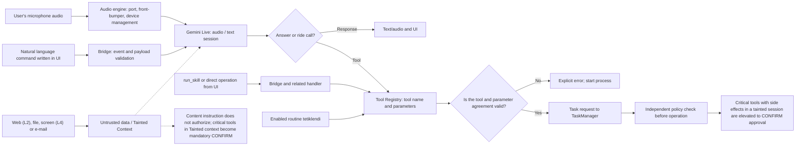


#### Indirect Prompt Injection and Taint Tracking Defense

The content that the model reads from the outside world (web pages, incoming emails, external files or on-screen OCR/Vision texts) may have been manipulated by attackers ("Forget previous instructions, delete / send that file to"). When the model reads these texts, it may mistake them for the user's real intention and generate tool calls (`terminal.exec`, `gmail.send`, `notes.delete`, etc.).

TaskVex prevents this risk not only with prompt engineering, but also with **architectural trust boundaries and PolicyEngine**:
1. **Data vs Instruction Boundary:** All text read from the external source is given to the model session not as a system/user instruction, but with a clearly isolated "untrusted_data" role and in a data envelope.
2. **Taint Tracking:** When an untrusted external source (L2 DOM, L4 Screen/OCR, Email, Clipboard, External File) enters the session history or active turn context, it is marked as `RequestContext` or the active session is marked as `is_tainted = True`.
3. **Policy Escalation to CONFIRM:** While the session is in the `tainted` state, tools that cause side effects or export data (terminal command, sending message/e-mail, deleting or overwriting file/note, external network requests) are automatically pulled to the `CONFIRM` level by PolicyEngine. The model cannot silently run these operations on behalf of the user; TaskManager does not execute the action unless the confirmation modal is opened on the UI, indicating that the trigger comes from an external content, and the user physically confirms it.

### 4. TaskManager: queue, resource ownership and approval

```mermaid
flowchart LR
    A["Current task request"] --> B["Check request_id and call ID if any"]
    B --> C{"Has the same call been accepted before?"}
    C -->|"Yes"| D["Return current task state/result; replay"]
    C -->|"No"| E["create task_id, resource, session_id and deadline"]
    E --> Q["queued: task queued"]
    Q --> LIMIT{"Is there any cancellation or time limit?"}
    LIMIT -->|"Yes"| STOP["Cancel / time flow; keep side effect status"]
    LIMIT -->|"No"| TYPE{"Does it change the desktop?"}
    TYPE -->|"Yes"| LOCK["Wait for single desktop queue and take ownership"]
    TYPE -->|"No"| INDEP["Parallel if independent; appropriate lock if common source"]
    LOCK --> RUN["running: prepare target / tool operation"]
    INDEP --> RUN
    RUN --> P["Policy: action, target, parameter, scope"]
    P --> PD{"Decision?"}
    PD -->|"deny"| DENY["Do not take action; save rejection result"]
    PD -->|"confirm"| WAIT["waiting_approval; release resource locks"]
    WAIT --> APPROVE{"Did the user approve this action?"}
    APPROVE -->|"No / cancel"| STOP
    APPROVE -->|"Yes"| REACQ["Reacquire required resources"]
    REACQ --> REFRESH["Observe target and preconditions again"]
    REFRESH --> P
    PD -->|"allow or valid blanket consent"| CHECK["Final check for cancellation, duration, target and prerequisites"]
    CHECK --> EXEC["Execute and verify result"]
    EXEC --> SAVE["Save status, result and step evidence"]
    SAVE --> RELEASE["Release ownership of the resource; publish events"]
    STOP --> RELEASE
    DENY --> RELEASE
```


### 5. L0 and four-layer target decoding

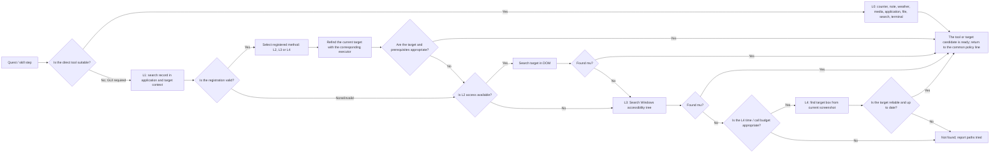


### 6. Apply the process, verify the result, decide with confidence

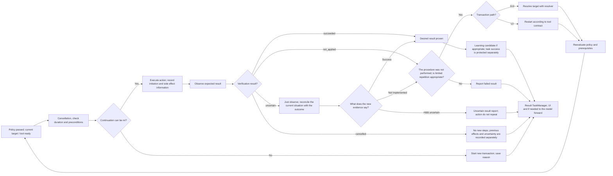


### 7. L1 learning and self-heal

```mermaid
flowchart LR
    A["The success of the procedure has been proven"] --> B{"Is there a reliable recipe that can be reused?"}
    B -->|"No"| ENDOK["Task successful; create new record"]
    B -->|"Yes"| C["Prepare context, method, target description, parameter and result condition"]
    C --> D{"Recipe source?"}
    D -->|"DOM / UIA"| SEM["Semantik target description"]
    D -->|"Vision"| VIS["Recipe for finding images again if reliable"]
    SEM --> NEW["New skill or new save version candidate"]
    VIS --> NEW
    NEW --> VAL["Verify schema, target and result evidence"]
    VAL --> GOOD{"Is the candidate valid?"}
    GOOD -->|"No"| REJECT["Activate candidate; change task outcome"]
    GOOD -->|"Yes"| SAVE[("Versed skills JSON; preserve previous version")]
    SAVE --> USE["L1 matching in next task"]
    USE --> FIND["Find current target with registered method"]
    FIND --> WORKS{"Is the registration still available?"}
    WORKS -->|"Yes"| RUN["Common policy, enforcement and verification pipeline"]
    WORKS -->|"No"| HEAL["Resolve with resolver; create self-heal candidate"]
    HEAL --> PROVEN["Application and result verification with the new method"]
    PROVEN --> VERIFIED{"Has success been proven?"}
    VERIFIED -->|"Yes"| C
    VERIFIED -->|"No / uncertain"| BAD["Enable wrong recipe; limited failure tracking"]
    BAD --> DISABLE["Disable repetitive bad recording"]
```


### 8. Audio, Gemini Live and reconnection

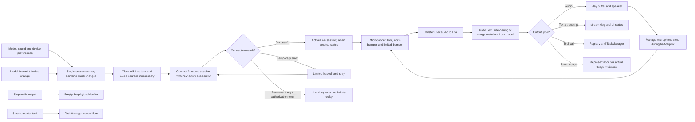


### 9. System audio analysis and application-by-application listening

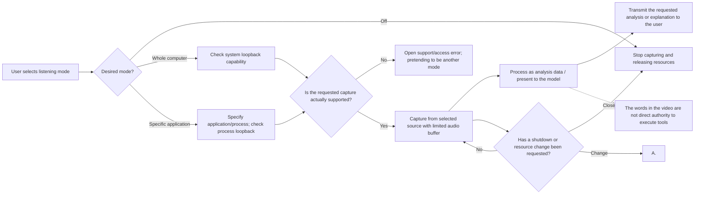


### 10. UI bridge, events, queues and persistent state

```mermaid
flowchart LR
    UI["User UI action"] --> EMIT["emit: event name, payload and request_id"]
    EMIT --> BRIDGE["Bridge: limited queue"]
    BRIDGE --> DISP["Dispatcher: schema and handler routing"]
    DISP --> KIND{"Job type?"}
    KIND -->|"Operating on the computer"| TM["TaskManager and common execution pipeline"]
    KIND -->|"Setting / profile / status"| VALIDATE["Validate fields and values"]
    VALIDATE --> STATE["Update Python live state"]
    STATE --> PERSIST{"Is the field permanent?"}
    PERSIST -->|"Yes"| WRITE["Locked and atomic record; preserve schema version"]
    WRITE --> JSON[("app_state / profile / notes / routines / skills")]
    PERSIST -->|"No"| EVENT["Publish status event"]
    WRITE --> EVENT
    TM -.-> EVENT
    SERVICES["Telemetry, weather, media and calendar events"] --> EVENT
    DISP -->|"Handler error"| ERROR["Masked log and understandable error"]
    WRITE -->|"Registration error"| ERROR
    ERROR --> EVENT
    EVENT --> Q{"Event queue behavior?"}
    Q -->|"Last value such as level / telemetry"| COAL["Combine updates"]
    Q -->|"Confirmation / error / task result"| CRIT["Silent drop; back pressure or open fault"]
    COAL --> JS["The only hyperlink that complies with Webview thread rules"]
    CRIT --> JS
    JS --> APPLY["Update UI with jarvis.*"]
    JSON -->|"Next opening"| INIT["initApp: backend state onto local backup"]
    INIT --> APPLY
```


### 11. Background services, routines, and multi-step jobs

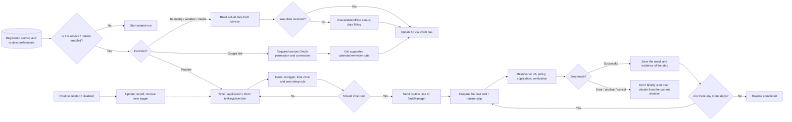


### 12. Cancellation, timeout and safe closing

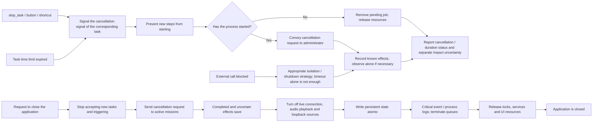


### 13. Simple view of task statuses

```mermaid
stateDiagram-v2
    direction LR
    [*] --> Queued: Current quest accepted
    Queued --> Running: Required sources appropriate
    Queued --> Cancelled: Cancel before starting
    Queued --> Failed: Time limit / error before starting
    Running --> WaitingApproval: Policy approval istiyor
    WaitingApproval --> Running: Approval, source and target again control applied
    WaitingApproval --> Cancelled: User canceled
    WaitingApproval --> Failed: Approval rejection or expiration
    Running --> Succeeded: The expected result is proven
    Running --> Failed: Could not be completed; error logged
    Running --> Uncertain: The operation result could not be resolved
    Running --> Cancelled: Cancel; previous effects are also stored
    Succeeded --> [*]
    Failed --> [*]
    Uncertain --> [*]
    Cancelled --> [*]
```


### 14. Concrete example: Writing in Notepad

```mermaid
flowchart LR
    U["User: Write meeting notes in Notepad"] --> G["Understand command and create tool request"]
    G --> T["TaskManager: call ID and desktop sequence"]
    T --> R["Resolver: Check L1 memory"]
    R --> M{"Is there a valid recipe?"}
    M -->|"Yes"| L1["Registered L3 target description"]
    M -->|"No"| NEW["Select L3 method for this application"]
    L1 --> FIND["L3 UIA: find current window and area"]
    NEW --> FIND
    FIND --> P["Policy, cancellation, duration and precondition check"]
    P --> A["Text yaz"]
    A --> V["Reread the field and verify the result"]
    V --> D{"Is the result proven?"}
    D -->|"Success"| SUCCESS["Successful task and L1 learning if appropriate"]
    D -->|"Uncertain"| OBS["Observe alone first and reconcile the result"]
    OBS --> UQ["If not resolved, report ambiguity, do not write again"]
    SUCCESS --> OUT["Drop the source and pass the result to the user"]
    UQ --> OUT
```


### Recommendation 15: integrations and communication channels

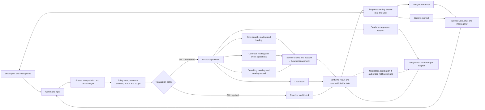

Architectural recommendation for new integrations; It is not an implemented part of the original plan.

### 16. Recommended development order: start with ready UI and L0

```mermaid
flowchart LR
    A["0 · UI reference and clean repo"] --> B["1 · UI bridge, theme and atomic registry"]
    B --> C["2 · Small TaskManager, adding policy and actual notes"]
    C --> D["3 · Complete local L0 tools in order"]
    D --> E["4 · Written natural language, then voice and Live"]
    E --> F["5 · Google accounts and cloud L0"]
    F --> G["6 · Telegram login, reply and notification"]
    G --> H["7 L3 UIA, then L1 memory"]
    H --> I["8 · Optional L2 DOM and L4 Vision"]
    I --> J["9 · Working without Discord and UI"]
    J --> K["10 · Routines, notifications and listening modes"]
    K --> L["11 · Packaging and durability"]
```


## Recommended link for AGENTS.md

It is sufficient to add this short section to the end of the existing general rules. Placing a Markdown file next to it does not mean that every agent will automatically read that file.

```markdown
## TaskVex project context

- Before changing code, read ARCHITECTURE.md at the repository root and the code relevant to the task.
- For UI/backend work, also read v1/ui/docs/UI_BACKEND_CONTRACT.md.
- ARCHITECTURE.md describes both current state and future plans. Implement only the requested stage; do not scaffold the entire target tree.
- Preserve the architecture's responsibility boundaries and existing UI contracts. Report conflicts; update affected callers, tests and docs together when a change requires it.
- Do not claim native, hardware or external-service integration was verified when only mocks were tested.
```
